# NefroCenter 0.11.1 — Guida d’uso illustrata

Manuale operativo del portale centrale. Esempi e schermate usano dati dimostrativi. Le autorizzazioni sono sempre verificate dal servizio.

Nel portale: **Guida** per la ricerca completa; **Aiuto pagina** per il tutorial contestuale. I video locali sono videoguide illustrate senza audio, con sottotitoli e trascrizione, non registrazioni di operazioni dal vivo.

## Indice

## Scegli un percorso

### Primi passi nel portale · Tutti

Impara a riconoscere sede, mese e strumenti di aiuto prima di lavorare sui dati.

[Primo accesso: entrare e orientarsi](#avvio) → [Dashboard: scegliere il centro da verificare](#dashboard) → [Guide e tutorial: trovare la risposta giusta](#guida) → [Sicurezza: gestire telefono, recuperi e sessioni](#sicurezza)

### Compilare e inviare il mese · Compilatore

Registra il lavoro svolto, correggi le segnalazioni e invia le presenze al responsabile.

[Presenze: registrare e correggere un turno](#presenze) → [Da completare: correggere una segnalazione](#completare) → [Riepilogo: controllare i totali e chiudere il mese](#riepilogo) → [Approvazione mese: seguire i tre passaggi](#approvazioni)

### Verificare il lavoro della sede · Responsabile centro

Controlla copertura e registrazioni, completa le verifiche e inoltra il mese a HR.

[Copertura turni: trovare e gestire le scoperture](#copertura) → [Presenze: registrare e correggere un turno](#presenze) → [Controlli: leggere anomalie e salvare la verifica](#controlli) → [Approvazione mese: seguire i tre passaggi](#approvazioni) → [Uscite e dotazioni: completare la riconsegna](#uscite)

### Gestire un fascicolo e i documenti · HR centrale

Apri la persona, verifica gli allegati delle sedi e segui le attività amministrative.

[Dipendenti: aprire o creare un fascicolo](#dipendenti) → [Onboarding: aggiornare un’attività di ingresso](#onboarding) → [Documenti: caricare un file e seguirne la verifica](#documenti) → [Documenti HR: controllare gli allegati delle sedi](#hrcentrale) → [Scadenze: risalire al dato da aggiornare](#scadenze) → [Uscite e dotazioni: completare la riconsegna](#uscite)

### Preparare la chiusura HR · HR centrale

Controlla il mese, approva la versione verificata e prepara il file per il consulente.

[Dashboard: scegliere il centro da verificare](#dashboard) → [Approvazione mese: seguire i tre passaggi](#approvazioni) → [Paghe: preparare e verificare il tracciato](#paghe) → [Comunicazioni: dal modello all’invio verificato](#comunicazioni) → [Promemoria: configurare destinatari e scadenze](#promemoria)

### Preparare una sede e gli accessi · Amministratore

Configura centro, recapiti, regole e account; verifica copie di sicurezza e invii prima dell’uso.

[Centri: creare una sede o importare il modello](#centri) → [Strutture: aggiornare la rubrica condivisa](#strutture) → [Parametri: configurare fasce, causali e regole](#parametri) → [Utenti e permessi: assegnare il ruolo corretto](#utenti) → [Backup ed esportazioni: scegliere il file corretto](#esportazioni) → [Promemoria: configurare destinatari e scadenze](#promemoria)

### Leggere l’andamento delle sedi · Direzione / lettore

Confronta presenze e copertura distinguendo dati completi, mancanti e semplici indicatori.

[Dashboard: scegliere il centro da verificare](#dashboard) → [Statistiche: confrontare dati completi e dati mancanti](#statistiche) → [Copertura turni: trovare e gestire le scoperture](#copertura) → [Riepilogo: controllare i totali e chiudere il mese](#riepilogo)

- [Primo accesso: entrare e orientarsi](#avvio)
- [Dashboard: scegliere il centro da verificare](#dashboard)
- [Da completare: correggere una segnalazione](#completare)
- [Presenze: registrare e correggere un turno](#presenze)
- [Dipendenti: aprire o creare un fascicolo](#dipendenti)
- [Anagrafica: identificare la persona nel registro](#anagrafica)
- [Recapiti: distinguere i contatti personali e aziendali](#recapiti)
- [Rapporto di lavoro: registrare i dati attuali](#contratto)
- [Amministrazione: verificare i riferimenti di pagamento](#amministrazione)
- [Qualifiche: registrare scadenze e campi aggiuntivi](#qualifiche)
- [Onboarding: aggiornare un’attività di ingresso](#onboarding)
- [Documenti: caricare un file e seguirne la verifica](#documenti)
- [Scadenze: risalire al dato da aggiornare](#scadenze)
- [Modello onboarding: preparare i nuovi fascicoli](#modellohr)
- [Personale di gruppo: collegare sedi e decorrenze](#personale)
- [Documenti HR: controllare gli allegati delle sedi](#hrcentrale)
- [Accordi e calcoli: verificare il mese della persona](#accordi)
- [Riepilogo: controllare i totali e chiudere il mese](#riepilogo)
- [Controlli: leggere anomalie e salvare la verifica](#controlli)
- [Parametri: configurare fasce, causali e regole](#parametri)
- [Centri: creare una sede o importare il modello](#centri)
- [Statistiche: confrontare dati completi e dati mancanti](#statistiche)
- [Backup ed esportazioni: scegliere il file corretto](#esportazioni)
- [Paghe: preparare e verificare il tracciato](#paghe)
- [Utenti e permessi: assegnare il ruolo corretto](#utenti)
- [Sicurezza: gestire telefono, recuperi e sessioni](#sicurezza)
- [Carico: registrare i totali per fascia](#carico)
- [Guide e tutorial: trovare la risposta giusta](#guida)
- [Strutture: aggiornare la rubrica condivisa](#strutture)
- [Comunicazioni: dal modello all’invio verificato](#comunicazioni)
- [Approvazione mese: seguire i tre passaggi](#approvazioni)
- [Copertura turni: trovare e gestire le scoperture](#copertura)
- [Promemoria: configurare destinatari e scadenze](#promemoria)
- [Uscite e dotazioni: completare la riconsegna](#uscite)

## Primo accesso: entrare e orientarsi

**A chi serve:** Tutti gli utenti con un account nominativo

Accedere al portale e riconoscere subito sede, mese e ruolo con cui si lavora.

**Prima di iniziare:**

- Installazione aziendale: indirizzo HTTPS, nome utente, password iniziale e codice di attivazione forniti dall’amministratore.
- Demo pubblica: scegli un ruolo; i dati sono fittizi e ogni visitatore lavora sulla propria copia.

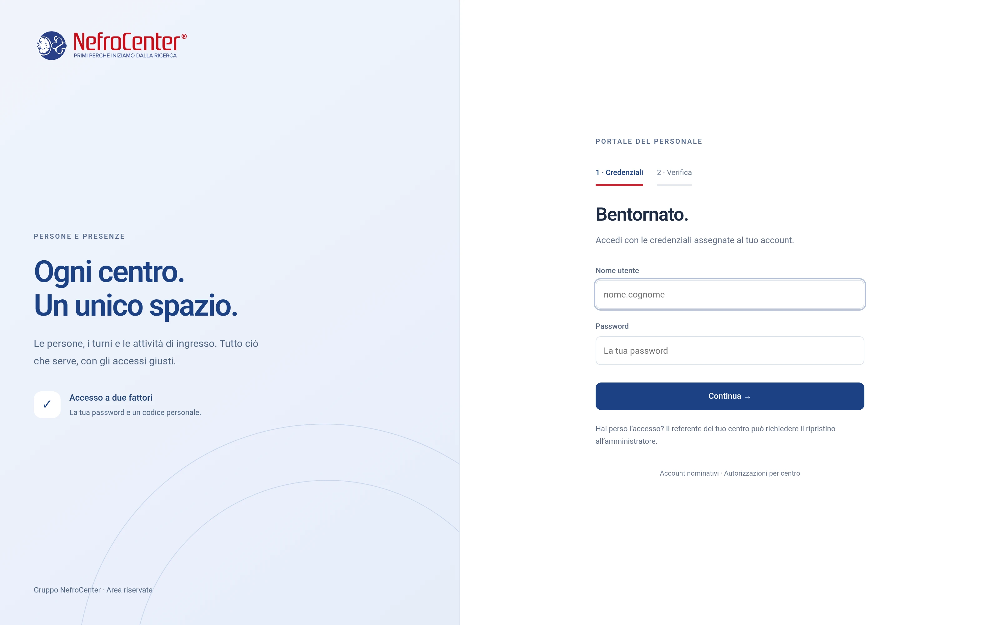

*Schermata dimostrativa del portale.*

1. Apri l’indirizzo del portale. Nell’installazione aziendale inserisci nome utente e password iniziale.
2. Al primo accesso usa il codice di attivazione. Collega l’app Authenticator tramite QR, inserisci il codice a 6 cifre e scegli una password personale di almeno 12 caratteri.
3. Conserva i codici di recupero fuori dal telefono e conferma di averli salvati. Nei successivi accessi servono password e Authenticator; ogni codice di recupero si usa una sola volta.
4. Una volta entrato, controlla il centro in alto, il mese e il ruolo accanto al tuo nome. Cambia centro prima di aprire un fascicolo o compilare il registro.
5. Apri Guide e tutorial per cercare una procedura; Aiuto per questa pagina mantiene il contesto del lavoro. Quando termini, premi Esci.

**Esempio pratico:** Nella demo scegli HR centrale, apri Documenti HR e poi cambia ruolo in Compilatore: i fascicoli riservati non sono più accessibili.

**Risultato atteso:** Vedi i centri assegnati e le pagine del tuo ruolo; la sede e il mese corretti sono visibili nell’intestazione.

**Problemi frequenti:**

- Authenticator rifiutato: abilita data e ora automatiche sul telefono e prova un codice nuovo.
- Attivazione scaduta: chiedi un nuovo codice all’amministratore; il programma non lo spedisce automaticamente per email.
- Connessione interrotta: attendi il ripristino, ricarica e controlla quali dati risultano salvati prima di ripetere l’operazione.

**Videoguida locale:** [video illustrato](assets/guides/avvio.mp4) · [trascrizione](assets/guides/avvio.txt)

## Dashboard: scegliere il centro da verificare

**A chi serve:** Tutti, limitatamente ai centri autorizzati

Individuare le sedi da controllare nel mese e aprire il loro registro.

**Prima di iniziare:**

- Controlla il mese selezionato.
- I valori comprendono soltanto i centri autorizzati al tuo account.

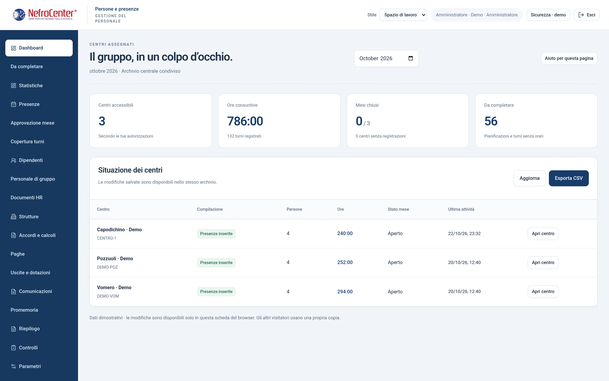

*Schermata dimostrativa del portale.*

1. Apri Dashboard e seleziona il mese del confronto.
2. Leggi insieme turni e ore: un turno senza orari è registrato, ma non produce ore stimate.
3. Nella tabella confronta compilazione, persone, ore e ultima attività. Il numero di persone attive non equivale al personale presente ogni giorno.
4. Premi Apri centro sulla sede da approfondire. Per trovare gli elementi incompleti usa Da completare.
5. Torna alla Dashboard e premi Aggiorna dopo le correzioni; la pagina si aggiorna anche ogni minuto. Se disponibile, Esporta CSV scarica il quadro dei centri.

**Esempio pratico:** Due sedi mostrano 40 turni ciascuna, ma una ha meno ore: prima di confrontare il carico, controlla se mancano ingresso e uscita.

**Risultato atteso:** Sai quale centro richiede un controllo e puoi raggiungerlo senza cambiare manualmente più filtri.

**Problemi frequenti:**

- Centro assente: verifica le assegnazioni con l’amministratore.
- Ore basse: apri i dati prima di concludere che siano state lavorate meno ore.
- Mese vuoto: verifica periodo e sede; l’assenza di dati non dimostra l’assenza di attività.

**Videoguida locale:** [video illustrato](assets/guides/dashboard.mp4) · [trascrizione](assets/guides/dashboard.txt)

## Da completare: correggere una segnalazione

**A chi serve:** Ogni utente vede le attività consentite dal proprio ruolo

Passare da una segnalazione al dato da correggere e controllare che il problema sia risolto.

**Prima di iniziare:**

- Scegli il mese per le presenze; le scadenze HR descrivono invece la situazione attuale.
- Sono visibili soltanto le attività e i dettagli consentiti al tuo ruolo.

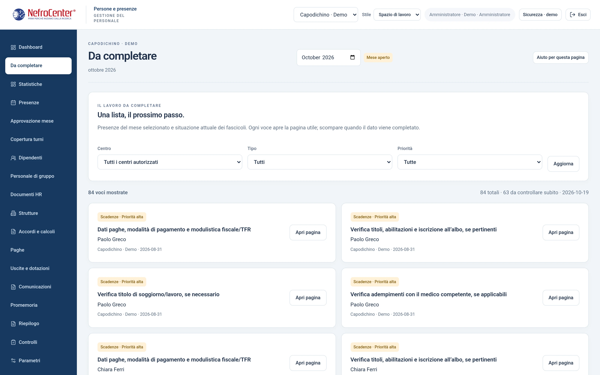

*Schermata dimostrativa del portale.*

1. Apri Da completare. Seleziona centro, categoria e priorità; usa la ricerca per restringere l’elenco.
2. Leggi persona, data e motivo. Per una registrazione futura verifica se si tratta semplicemente di un turno ancora pianificato.
3. Apri la voce: il portale porta alla pagina di origine, per esempio Presenze, fascicolo o Controlli.
4. Correggi e salva nella pagina aperta. Inserisci un consuntivo solo dopo aver verificato che il turno sia stato svolto.
5. Torna a Da completare e aggiorna l’elenco. Verifica che la segnalazione sia scomparsa o che il suo contenuto corrisponda ai dati corretti.

**Esempio pratico:** Una voce segnala un turno senza orari: apri il registro, inserisci ingresso e uscita verificati e aggiorna la lista.

**Risultato atteso:** L’elenco riflette la correzione effettuata; non occorre cancellare manualmente la segnalazione.

**Problemi frequenti:**

- Non puoi aprire un fascicolo: chiedi il corretto accesso al referente, senza usare l’account di un collega.
- La voce rimane: riapri il dato e controlla che il salvataggio sia riuscito e che la causa indicata sia stata risolta.

**Videoguida locale:** [video illustrato](assets/guides/completare.mp4) · [trascrizione](assets/guides/completare.txt)

## Presenze: registrare e correggere un turno

**A chi serve:** Compilatori, responsabili e amministratori secondo i permessi del centro; lettori in consultazione

Salvare un turno previsto o svolto distinguendo correttamente pianificazione, lavoro e assenze.

**Prima di iniziare:**

- Il registro deve essere aperto e, se il flusso è attivo, non deve essere già inviato in approvazione.
- Compilatori e responsabili operano secondo i permessi del centro; HR e lettori consultano il registro.

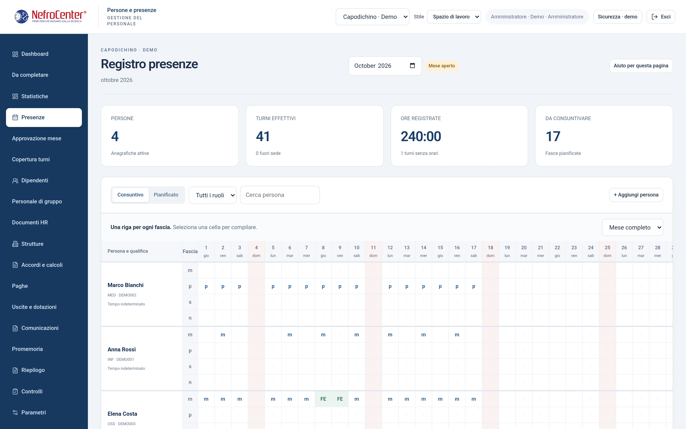

*Schermata dimostrativa del portale.*

1. Scegli centro e mese. Seleziona Consuntivo per il lavoro svolto oppure Pianificato per i turni previsti.
2. Cerca la persona o filtra la qualifica. Su uno schermo piccolo puoi usare la vista 7 giorni: i totali restano mensili.
3. Apri la cella della persona e del giorno. Controlla la fascia, poi scegli la causale ammessa.
4. Per un turno di lavoro inserisci ingresso, uscita e pausa reali, se il tuo profilo li può modificare. Per l’uscita dopo mezzanotte seleziona Uscita il giorno successivo.
5. Controlla la sede effettiva, l’eventuale festivo e la nota. Premi Salva presenza e verifica la cella e i totali aggiornati.
6. Per correggere, riapri la stessa cella. Elimina rimuove una registrazione soltanto se il tuo ruolo e il centro lo consentono.

**Esempio pratico:** Per un turno effettivo dalle 08:00 alle 14:00 con 30 minuti di pausa, registra Consuntivo: le ore note risultano 5:30.

**Risultato atteso:** La registrazione compare nella fascia e nel livello scelti. Le ore lavorate restano distinte dai crediti delle assenze.

**Problemi frequenti:**

- Mese inviato: serve una restituzione nella pagina Approvazione mese; mese chiuso: serve una riapertura motivata.
- Campo disabilitato: il tuo profilo non può modificarlo; chiedi al responsabile.
- Dati cambiati: ricarica, confronta la registrazione aggiornata e ripeti soltanto la correzione ancora necessaria.

### Impostazioni e campi

| Campo | Effetto | Esempio |
|---|---|---|
| Consuntivo / Pianificato | Separa quanto svolto da quanto previsto; il pianificato non genera ore lavorate effettive. | Pianifica il 5 novembre, poi registra il consuntivo dopo il turno. |
| Causale della cella | Determina lavoro, assenza o riposo per persona, giorno e fascia. | FER per la fascia di ferie autorizzata. |
| Ingresso effettivo | Orario di inizio realmente registrato quando il ruolo può modificarlo. | 08:05. |
| Uscita effettiva | Orario di fine; con passaggio al giorno successivo consente il notturno. | 14:05 oppure 06:00 del giorno seguente. |
| Pausa effettiva | Minuti da sottrarre alla durata della presenza lavorativa. | 30. |
| Sede di lavoro | Centro di effettuazione del turno; una sede diversa conta come fuori sede. | Centro B per una sostituzione. |
| Festivo riconosciuto | Classifica il turno come festivo quando il calendario o il permesso lo consentono. | Flag verificato per una festività autorizzata. |
| Nota della registrazione | Spiega un’eccezione del turno senza inserire informazioni sanitarie non necessarie. | Sostituzione concordata con il responsabile. |
| Mese completo / 7 giorni | Cambia soltanto la porzione di calendario visibile; i totali restano mensili. | 7 giorni per lavorare dal telefono. |
| Ricerca persona e filtro ruolo | Restringe l’elenco mostrato, senza cancellare registrazioni. | Cerca Anna oppure seleziona Infermiere. |

**Videoguida locale:** [video illustrato](assets/guides/presenze.mp4) · [trascrizione](assets/guides/presenze.txt)

## Dipendenti: aprire o creare un fascicolo

**A chi serve:** Responsabili dei centri assegnati, HR centrale e amministratori

Raccogliere i dati amministrativi della persona e ritrovare documenti, onboarding e scadenze.

**Prima di iniziare:**

- HR centrale e amministratori accedono a tutte le sedi; i responsabili soltanto a quelle assegnate.
- Prima di creare una persona, cerca nome e matricola per evitare doppioni.

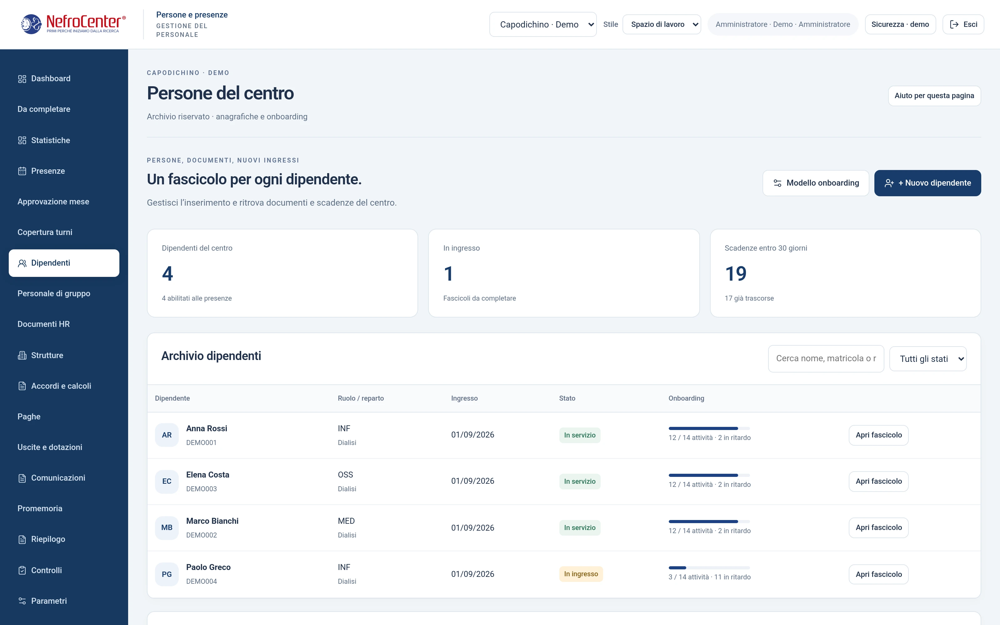

*Schermata dimostrativa del portale.*

1. Apri Dipendenti nel centro corretto. Cerca per nome, matricola o reparto e usa il filtro dello stato del rapporto.
2. Apri una persona esistente oppure premi Nuovo dipendente. Compila i dati identificativi e il ruolo nel registro.
3. Completa le sezioni pertinenti: Anagrafica, Recapiti, Rapporto di lavoro, Amministrazione e Qualifiche. Riferimento impostazioni spiega ogni campo.
4. Premi Salva fascicolo. Il primo salvataggio crea le attività onboarding dal modello della sede e dalla data d’ingresso.
5. Apri Documenti per gli allegati e Scadenze per le date da controllare. Struttura di riferimento mostra i recapiti condivisi della sede.
6. Prima di passare a Presenze della persona o Accordo del mese salva le modifiche del fascicolo.

**Esempio pratico:** Crea una persona fittizia con ingresso il 1° novembre: dopo Salva fascicolo trovi le attività onboarding generate dal modello della sede.

**Risultato atteso:** Il fascicolo è conservato sul server centrale ed è consultabile da HR e dai responsabili autorizzati.

**Problemi frequenti:**

- Matricola già usata: controlla l’anagrafica esistente prima di crearne una nuova.
- Codice fiscale o IBAN non valido: confronta il dato con la fonte; il controllo del formato non prova l’identità o la titolarità.
- Campo richiesto incompleto: il fascicolo può restare una bozza, ma il dato mancante viene segnalato.

**Videoguida locale:** [video illustrato](assets/guides/dipendenti.mp4) · [trascrizione](assets/guides/dipendenti.txt)

## Anagrafica: identificare la persona nel registro

**A chi serve:** Utenti autorizzati al fascicolo HR

Salvare identità, matricola e abilitazione al registro senza confondere lo stato del rapporto con i permessi di accesso.

**Prima di iniziare:**

- Apri il fascicolo in Dipendenti.
- Tieni a disposizione i riferimenti identificativi verificati secondo la procedura aziendale.

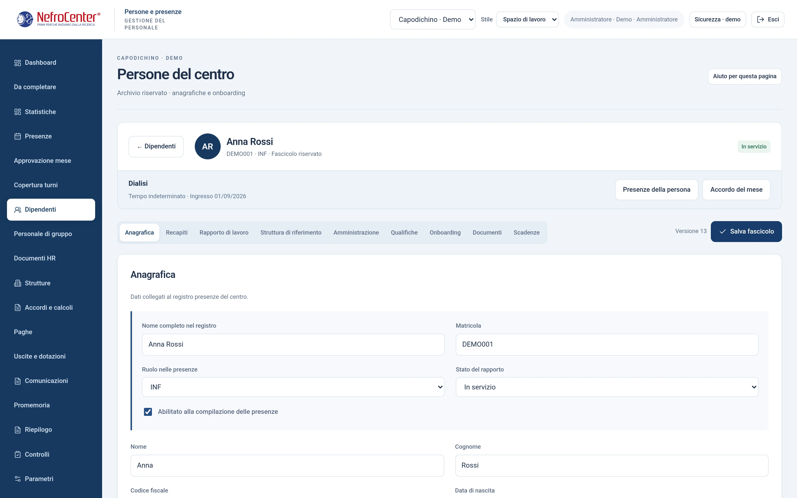

*Schermata dimostrativa del portale.*

1. Apri Anagrafica e confronta nome, cognome, codice fiscale e dati di nascita con la fonte verificata.
2. Controlla Nome completo nel registro, Matricola e Ruolo nelle presenze: sono i riferimenti usati nelle pagine operative.
3. Imposta Stato del rapporto e Abilitato alla compilazione delle presenze separatamente. La spunta riguarda la persona nel registro e non crea un account di accesso.
4. Completa gli estremi e la scadenza del documento di identità, se previsti. Premi Salva fascicolo.
5. Riapri la scheda e controlla i riferimenti; in Scadenze verifica l’eventuale data del documento.

**Esempio pratico:** Una persona con rapporto cessato può conservare il fascicolo storico; l’abilitazione al registro viene gestita separatamente.

**Risultato atteso:** La persona è riconoscibile nel centro e la sua disponibilità nel registro rispecchia la scelta salvata.

**Problemi frequenti:**

- Matricola duplicata nel centro: verifica il fascicolo già presente.
- Un dipendente non compare nelle celle: controlla l’abilitazione al registro e i filtri della pagina Presenze.
- Salvare l’anagrafica non crea credenziali: gli account si gestiscono in Utenti e permessi.

### Impostazioni e campi

| Campo | Effetto | Esempio |
|---|---|---|
| Nome | Nome anagrafico distinto dal cognome; aiuta a identificare la persona. | Anna. |
| Cognome | Cognome anagrafico; insieme al nome può proporre il nome completo nel registro. | Esempio. |
| Codice fiscale | Identificativo normalizzato in maiuscolo; il formato viene controllato e i duplicati nel centro segnalati. | Trascrivi il codice dal documento, senza inventarlo. |
| Data di nascita | Data anagrafica che deve precedere oggi. | 1985-06-12. |
| Luogo di nascita | Comune o località di nascita riportati sul documento. | Napoli. |
| Cittadinanza | Cittadinanza dichiarata e verificata amministrativamente. | Italiana. |
| Provincia di nascita | Provincia relativa al luogo di nascita. | NA. |
| Tipo documento di identità | Specifica il documento usato per l’identificazione. | Carta d’identità. |
| Numero documento | Riferimento del documento identificativo. | Numero letto sul documento. |
| Ente di rilascio | Autorità che ha emesso il documento. | Comune di esempio. |
| Data di rilascio | Data iniziale di validità documentale. | 2022-05-10. |
| Scadenza documento | Alimenta le scadenze HR; non può precedere il rilascio. | 2032-05-10. |
| Nome completo nel registro | Nome visualizzato nelle presenze; obbligatorio, proposto da nome e cognome quando possibile. | Anna Esempio. |
| Matricola | Codice della persona nel centro, univoco all’interno della sede e necessario nei tracciati che lo richiedono. | P0017. |
| Ruolo nelle presenze | Qualifica scelta tra quelle del centro; entra nei filtri e nei conteggi di carico pertinenti. | Infermiere. |
| Stato del rapporto | In ingresso, In servizio o Cessato: descrive la fase del rapporto e filtra l’elenco HR. | In ingresso prima del primo giorno. |
| Abilitato alla compilazione delle presenze | Rende la persona disponibile nelle nuove compilazioni; le registrazioni storiche restano visibili. | Disattivato dopo la cessazione verificata. |

**Videoguida locale:** [video illustrato](assets/guides/anagrafica.mp4) · [trascrizione](assets/guides/anagrafica.txt)

## Recapiti: distinguere i contatti personali e aziendali

**A chi serve:** Utenti autorizzati al fascicolo HR

Aggiornare indirizzi e recapiti che l’ufficio può usare per le attività amministrative.

**Prima di iniziare:**

- Apri il fascicolo corretto.
- Verifica a chi appartiene ciascun indirizzo email prima di registrarlo.

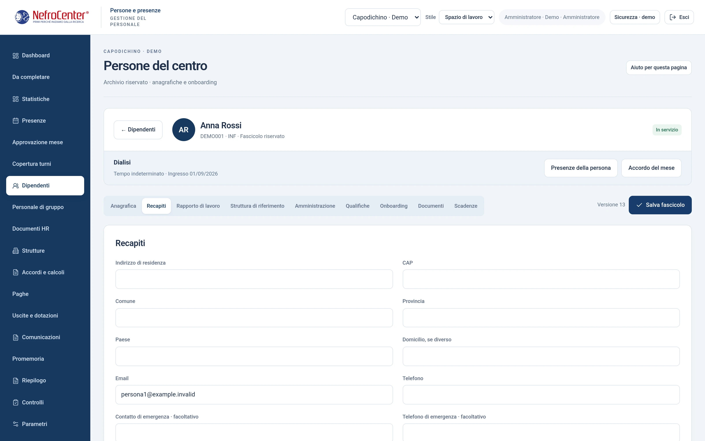

*Schermata dimostrativa del portale.*

1. Apri Recapiti e completa la residenza: indirizzo, CAP, comune, provincia e Paese.
2. Indica il domicilio quando diverso. Registra email personale, telefono, email aziendale e PEC nei rispettivi campi.
3. Se previsto dalla procedura aziendale, inserisci nominativo e telefono del contatto di emergenza.
4. Premi Salva fascicolo e riapri Recapiti per controllare i valori.
5. Per un invio usa Comunicazioni: la lista sceglie esplicitamente il campo email da usare. Salvare un recapito non invia un messaggio.

**Esempio pratico:** L’email personale serve al fascicolo; una lista aziendale configurata su Email aziendale usa il campo aziendale, non quello personale.

**Risultato atteso:** Il fascicolo conserva contatti distinti; chi prepara una comunicazione può selezionare il recapito corretto.

**Problemi frequenti:**

- Email non valida: inserisci un solo indirizzo nel campo e correggi eventuali spazi o errori di battitura.
- Destinatario assente nell’anteprima: controlla il campo email scelto dalla lista e salva prima il fascicolo.

### Impostazioni e campi

| Campo | Effetto | Esempio |
|---|---|---|
| Indirizzo di residenza | Via, numero civico e dettagli della residenza. | Via Esempio 10. |
| CAP | Codice postale della residenza, conservato come testo. | 80100. |
| Comune | Comune di residenza. | Napoli. |
| Provincia | Provincia della residenza. | NA. |
| Paese | Stato della residenza. | Italia. |
| Domicilio, se diverso | Indirizzo alternativo quando rilevante per il rapporto. | Via Esempio 20, Pozzuoli. |
| Email | Recapito personale; viene controllata la struttura, senza inviare messaggi. | persona@example.org. |
| Telefono | Recapito telefonico della persona. | +39 seguito dal numero verificato. |
| Contatto di emergenza, facoltativo | Riferimento da usare secondo la procedura aziendale, se necessario. | Nome e relazione del contatto indicato. |
| Telefono di emergenza, facoltativo | Numero del contatto di emergenza. | Numero fornito e verificato dalla persona. |
| PEC, se pertinente | Indirizzo PEC registrato come recapito, senza invio automatico. | persona@pec.example.org. |
| Email aziendale | Recapito lavorativo distinto dall’email personale. | nome.cognome@example.org. |

**Videoguida locale:** [video illustrato](assets/guides/recapiti.mp4) · [trascrizione](assets/guides/recapiti.txt)

## Rapporto di lavoro: registrare i dati attuali

**A chi serve:** Utenti autorizzati al fascicolo HR

Conservare i riferimenti del rapporto attuale e capire quando usare lo storico con decorrenze.

**Prima di iniziare:**

- Apri il fascicolo della persona.
- Disponi dei dati contrattuali verificati; gli esempi della guida non sono condizioni da applicare.

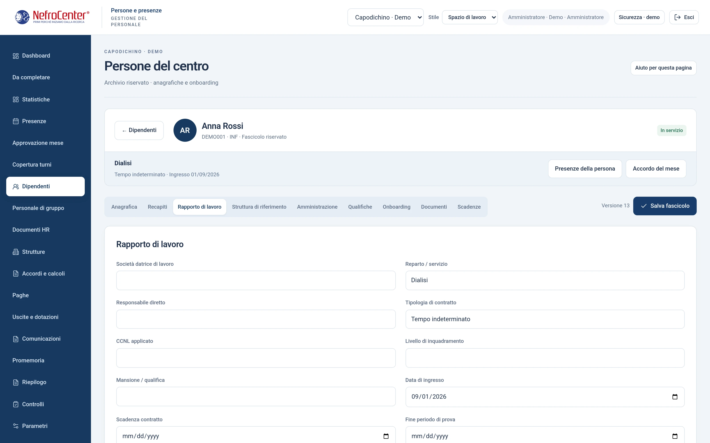

*Schermata dimostrativa del portale.*

1. Apri Rapporto di lavoro e indica società, reparto, responsabile, tipologia, CCNL, livello e mansione pertinenti.
2. Inserisci data d’ingresso, eventuale termine del rapporto e fine prova. Le date finali non possono precedere l’ingresso.
3. Registra ore settimanali e percentuale part-time secondo il contratto. Completa i riferimenti disponibili, come contratto, centro di costo, sede, badge e tutor.
4. Premi Salva fascicolo e controlla le scadenze generate dalle date.
5. Per conservare una variazione valida da una data precisa, usa lo storico in Personale di gruppo. Per un accordo economico del mese usa Accordi e calcoli.

**Esempio pratico:** Se l’orario cambia dal 1° dicembre, aggiorna i riferimenti attuali quando necessario e registra la decorrenza nello storico di gruppo.

**Risultato atteso:** Il fascicolo descrive il rapporto attuale; lo storico e gli accordi mensili rimangono funzioni distinte.

**Problemi frequenti:**

- Fine contratto precedente all’ingresso: verifica entrambe le date.
- Una modifica al fascicolo non ricostruisce automaticamente i contratti passati: usa Personale di gruppo.

### Impostazioni e campi

| Campo | Effetto | Esempio |
|---|---|---|
| Società datrice di lavoro | Ragione sociale della società titolare del rapporto. | Società Esempio Srl. |
| Reparto / servizio | Unità organizzativa; è usata anche nella ricerca dei fascicoli. | Servizio dialisi. |
| Responsabile diretto | Referente organizzativo della persona. | Nome del responsabile. |
| Tipologia di contratto | Descrive il rapporto attuale e compare nel collegamento alle presenze. | Tempo indeterminato. |
| CCNL applicato | Riferimento contrattuale amministrativo; non carica automaticamente tabelle normative. | Denominazione completa concordata con il consulente. |
| Livello di inquadramento | Livello riconosciuto nel rapporto, come testo. | Livello riportato nel contratto. |
| Mansione / qualifica | Mansione contrattuale, distinta dal ruolo selezionato nelle presenze. | Infermiere professionale. |
| Data di ingresso | Data che, al primo salvataggio, genera le scadenze relative dell’onboarding. | 2026-11-02. |
| Scadenza contratto | Termine eventuale del rapporto e fonte di scadenza; non può precedere l’ingresso. | 2027-10-31, oppure vuoto se non previsto. |
| Fine periodo di prova | Data amministrativa di verifica, non anteriore all’ingresso. | 2027-01-31. |
| Ore settimanali | Informazione contrattuale numerica maggiore di zero e fino a 168; non sostituisce gli accordi mensili. | 36. |
| Percentuale part-time | Percentuale contrattuale maggiore di zero e fino a 100. | 50 per metà tempo; non digitare il simbolo %. |
| Riferimento contratto | Identificativo che collega il fascicolo al documento del rapporto. | CTR-2026-015. |
| Centro di costo | Codice amministrativo per la classificazione economica. | CC-DIALISI-01. |
| Sede di lavoro contrattuale | Luogo contrattuale; non sostituisce la sede della singola presenza. | Centro Esempio. |
| Numero badge | Identificativo del badge aziendale; non attiva timbrature automatiche. | B0042. |
| Tutor di inserimento | Referente dell’affiancamento iniziale. | Nome del tutor. |

**Videoguida locale:** [video illustrato](assets/guides/contratto.mp4) · [trascrizione](assets/guides/contratto.txt)

## Amministrazione: verificare i riferimenti di pagamento

**A chi serve:** Utenti autorizzati al fascicolo HR

Conservare i dati amministrativi necessari ai referenti autorizzati.

**Prima di iniziare:**

- Apri il fascicolo e verifica la persona.
- Usa dati ricevuti e controllati tramite la procedura aziendale.

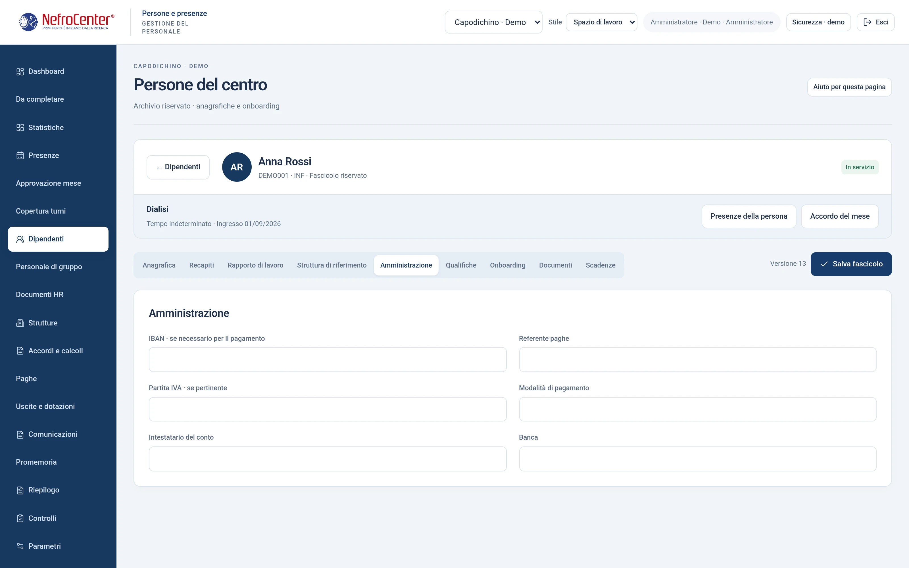

*Schermata dimostrativa del portale.*

1. Apri Amministrazione e indica referente paghe e modalità di pagamento, quando previsti.
2. Compila IBAN, intestatario e banca se pertinenti; confrontali con la documentazione disponibile.
3. Inserisci la Partita IVA soltanto per i rapporti che la richiedono.
4. Premi Salva fascicolo e controlla l’esito. Se il formato è rifiutato, correggi il dato nella sua sezione.

**Esempio pratico:** Dopo una variazione dell’IBAN verificata dall’ufficio, aggiorna il campo e salva; il portale conserva il riferimento ma non dispone bonifici.

**Risultato atteso:** I riferimenti sono disponibili nel fascicolo agli utenti HR autorizzati. Nessun pagamento viene eseguito.

**Problemi frequenti:**

- IBAN rifiutato: controlla caratteri e cifre sulla fonte, senza sostituirli con un esempio della guida.
- IBAN accettato: il controllo numerico non verifica a chi appartenga il conto.

### Impostazioni e campi

| Campo | Effetto | Esempio |
|---|---|---|
| IBAN | Coordinata di pagamento, normalizzata e verificata nel formato e nel controllo numerico. | Copia l’IBAN reale validato dall’ufficio; il software non effettua bonifici. |
| Referente paghe | Persona o ufficio cui riferirsi per il rapporto. | Studio paghe / referente amministrativo. |
| Partita IVA, se pertinente | Riferimento fiscale quando richiesto dalla natura del rapporto. | Partita IVA comunicata dal professionista. |
| Modalità di pagamento | Descrive il metodo amministrativo concordato. | Bonifico bancario. |
| Intestatario del conto | Intestazione da confrontare con la coordinata bancaria. | Nome e cognome dell’intestatario. |
| Banca | Istituto di riferimento del pagamento. | Banca indicata nella documentazione. |

**Videoguida locale:** [video illustrato](assets/guides/amministrazione.mp4) · [trascrizione](assets/guides/amministrazione.txt)

## Qualifiche: registrare scadenze e campi aggiuntivi

**A chi serve:** Utenti autorizzati al fascicolo HR

Tenere ordinati i riferimenti amministrativi delle qualifiche e i dati specifici della sede.

**Prima di iniziare:**

- Apri il fascicolo in Dipendenti.
- Controlla quali informazioni sono richieste dalle procedure della sede.

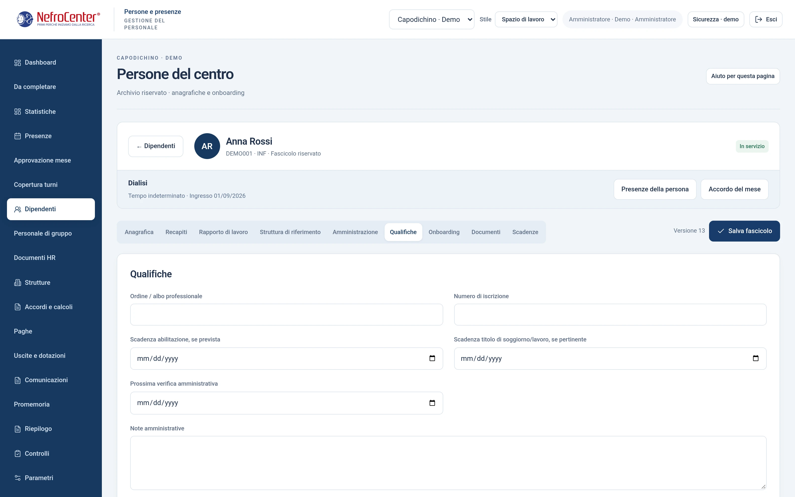

*Schermata dimostrativa del portale.*

1. Apri Qualifiche. Registra ordine o albo, numero e scadenza pertinente, se prevista.
2. Completa eventuale scadenza del titolo di soggiorno/lavoro e prossima verifica amministrativa quando necessarie.
3. Compila i campi personalizzati rispettando il tipo richiesto: testo, numero, data o Sì/No.
4. Usa le note per riferimenti amministrativi utili. Diagnosi e referti rimangono nei sistemi del medico competente.
5. Premi Salva fascicolo e apri Scadenze per controllare le date.

**Esempio pratico:** Un campo personalizzato di tipo Data può registrare la data di una verifica interna; il suo significato va concordato nel modello della sede.

**Risultato atteso:** Le date salvate alimentano le scadenze; i campi personalizzati richiesti e ancora vuoti restano segnalati.

**Problemi frequenti:**

- Campo del tipo sbagliato: correggi il valore oppure verifica la definizione nel Modello onboarding.
- Scadenza assente: controlla che la data sia stata compilata e salvata nel campo corretto.

### Impostazioni e campi

| Campo | Effetto | Esempio |
|---|---|---|
| Ordine / albo professionale | Organismo professionale pertinente alla mansione. | Ordine professionale e provincia. |
| Numero di iscrizione | Numero dell’iscrizione all’albo dichiarato. | Numero riportato sull’attestazione. |
| Scadenza abilitazione, se prevista | Data di verifica o scadenza pertinente che alimenta le scadenze HR. | 2027-06-30 solo se applicabile. |
| Scadenza titolo di soggiorno/lavoro | Termine da registrare soltanto quando pertinente al rapporto. | 2027-05-31. |
| Prossima verifica amministrativa | Promemoria datato per una verifica HR successiva. | 2027-01-15. |
| Note amministrative | Testo amministrativo fino a 2000 caratteri; non è spazio per diagnosi o password. | Attestato ricevuto, verifica in programma. |

**Videoguida locale:** [video illustrato](assets/guides/qualifiche.mp4) · [trascrizione](assets/guides/qualifiche.txt)

## Onboarding: aggiornare un’attività di ingresso

**A chi serve:** Utenti autorizzati al fascicolo HR

Assegnare responsabile, scadenza e stato a un’attività del nuovo dipendente.

**Prima di iniziare:**

- Salva prima il fascicolo, con la data d’ingresso.
- Le attività iniziali derivano dal modello del centro al momento della creazione.

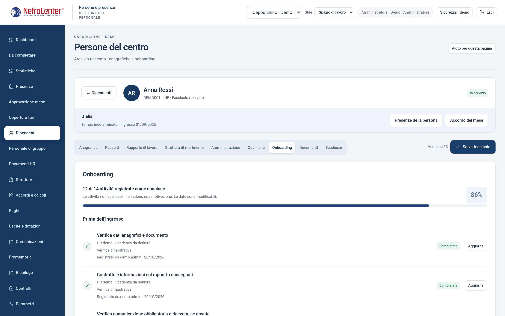

*Schermata dimostrativa del portale.*

1. Nel fascicolo apri Onboarding. Leggi descrizione, fase, responsabile e scadenza dell’attività.
2. Premi Aggiorna sull’attività da gestire e scegli Da fare, In corso, Completata o Non applicabile.
3. Indica responsabile e scadenza. Aggiungi una nota utile; Non applicabile richiede una motivazione.
4. Premi Salva attività e controlla lo stato e l’avanzamento della checklist.
5. Se cambiano ingresso o modello, verifica le attività esistenti una per una: non vengono rischedulate automaticamente.

**Esempio pratico:** Dopo la consegna effettiva del badge, il referente imposta la relativa attività su Completata e annota il riferimento della consegna.

**Risultato atteso:** La checklist mostra il lavoro aperto e concluso; lo storico identifica chi ha aggiornato l’attività.

**Problemi frequenti:**

- Nessuna attività nel fascicolo nuovo: salva prima la scheda.
- Spuntare Completata registra il lavoro svolto; non invia comunicazioni obbligatorie né esegue attività nei sistemi esterni.

### Impostazioni e campi

| Campo | Effetto | Esempio |
|---|---|---|
| Stato attività | Da fare, In corso, Completata o Non applicabile; gli ultimi due chiudono l’attività nel progresso. | In corso durante la raccolta dei documenti. |
| Scadenza attività | Data della singola attività, modificabile senza alterare il modello. | 2026-11-01 per un ingresso il 2 novembre. |
| Responsabile attività | Referente dell’adempimento, indicato come testo; non invia notifiche. | Ufficio HR. |
| Nota / motivo di non applicabilità | Registra evidenze o motivazione obbligatoria per Non applicabile. | Non richiesto per questa mansione, verificato con il referente. |

**Videoguida locale:** [video illustrato](assets/guides/onboarding.mp4) · [trascrizione](assets/guides/onboarding.txt)

## Documenti: caricare un file e seguirne la verifica

**A chi serve:** Caricamento e consultazione: responsabili autorizzati, HR centrale e amministratori

Caricare un allegato dalla sede e renderlo consultabile all’ufficio HR centrale.

**Prima di iniziare:**

- Apri e salva il fascicolo della persona nel centro corretto.
- Sono ammessi PDF, PNG e JPEG entro 6 MiB. Nella demo si usa soltanto l’allegato fittizio previsto.

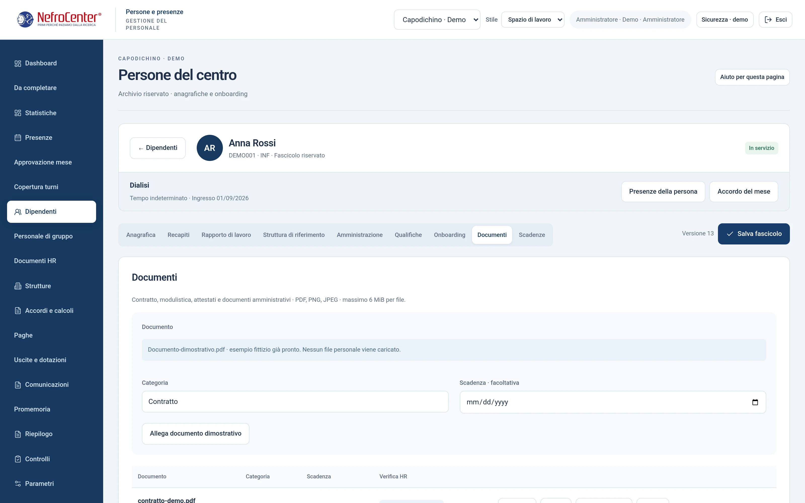

*Schermata dimostrativa del portale.*

1. Apri Documenti nel fascicolo. Scegli il file e indica categoria ed eventuale scadenza.
2. Premi Allega al fascicolo e attendi la conferma. Il nuovo file risulta Ricevuto · da verificare ed è già disponibile a HR centrale.
3. Apri Verifica e storico, poi Apri il documento da controllare. Confronta il contenuto con il fascicolo.
4. HR centrale o un amministratore sceglie Conferma: verificato da HR oppure Richiedi una correzione. Per la correzione scrive un motivo di almeno 8 caratteri, poi salva la verifica.
5. La sede legge la nota e risolve il problema. Se cambia il contenuto, allega un nuovo file, che nasce già da verificare. Su una richiesta aperta usa Richiedi una nuova verifica e spiega la correzione; il file originale non si riscrive.
6. Controlla esito e storico. Scarica solo se serve una copia locale; Rimuovi richiede una motivazione e non elimina le copie nei backup precedenti.

**Esempio pratico:** La sede carica un contratto incompleto. HR richiede la pagina mancante; la sede allega la versione completa e indica a quale richiesta si riferisce.

**Risultato atteso:** Sede e HR vedono lo stesso allegato, con esito, note e storico della verifica.

**Problemi frequenti:**

- Il responsabile può caricare e richiedere una nuova verifica; soltanto HR e amministratori registrano la decisione di verifica.
- Scaduto dipende dalla data: non cancella una verifica storica e un rinnovo richiede un nuovo allegato.
- File rifiutato: controlla formato reale e dimensione; rinominare l’estensione non converte il contenuto.
- Verifica cambiata da un collega: riapri la finestra e leggi l’esito corrente prima di salvare.

### Impostazioni e campi

| Campo | Effetto | Esempio |
|---|---|---|
| Documento | PDF, PNG o JPEG reale, massimo 6 MiB; il file si conserva nel database centrale. | Contratto_firmato.pdf. |
| Categoria | Classifica il documento per ricerca e consultazione HR. | Contratto, Formazione o Documento di identità. |
| Scadenza del documento | Data facoltativa che alimenta gli elenchi delle scadenze. | 2027-06-30 per un titolo che scade. |
| Motivazione rimozione | Spiega perché un allegato viene rimosso dal fascicolo attivo; i backup precedenti possono conservarlo. | Scansione errata sostituita con versione leggibile. |
| Nuovo esito | HR e amministratori registrano Verificato o Da correggere; la sede può richiedere una nuova verifica di un documento Da correggere. | Da correggere: manca una firma. |
| Nota per HR e per la sede | Motivazione condivisa con gli utenti HR autorizzati. Correzione e nuova verifica richiedono almeno 8 caratteri. | Firma mancante nell’ultima pagina. |
| Versione verifica | Valore gestito dal sistema: impedisce di sovrascrivere una decisione più recente. | Riapri la scheda se compare un conflitto. |
| Storico paginato | Mostra 25 decisioni per pagina, con autore, data, nota ed esito. | Passa agli eventi precedenti. |

**Videoguida locale:** [video illustrato](assets/guides/documenti.mp4) · [trascrizione](assets/guides/documenti.txt)

## Scadenze: risalire al dato da aggiornare

**A chi serve:** Utenti autorizzati al fascicolo HR

Trovare le date da controllare e aggiornarle nella sezione che le genera.

**Prima di iniziare:**

- Apri il fascicolo della persona.
- Le date dipendono dai dati effettivamente salvati: un campo vuoto non genera una scadenza.

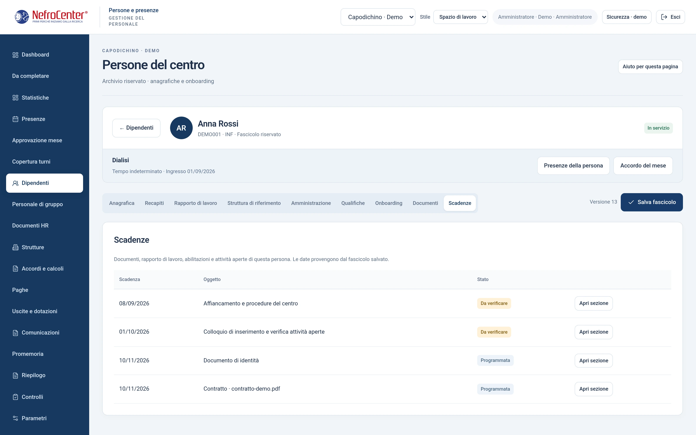

*Schermata dimostrativa del portale.*

1. Apri Scadenze e leggi oggetto, data e stato della voce.
2. Premi Apri sezione per raggiungere il campo di origine: contratto, qualifiche, onboarding, anagrafica o documento.
3. Verifica il dato con il referente e aggiorna la sezione pertinente. Per un documento rinnovato carica il nuovo allegato.
4. Salva, torna a Scadenze e controlla che la voce rifletta il dato aggiornato.

**Esempio pratico:** Il contratto viene prorogato: dopo la verifica dell’ufficio aggiorni la data nella sezione del rapporto e controlli la nuova scadenza.

**Risultato atteso:** La scadenza è coerente con il fascicolo; non hai creato un secondo elenco da mantenere manualmente.

**Problemi frequenti:**

- Una data trascorsa richiede controllo: non prova automaticamente un’inadempienza.
- Un’attività completata non è più tra quelle aperte: consultala in Onboarding.
- Per i riepiloghi via email usa la configurazione separata di Promemoria.

**Videoguida locale:** [video illustrato](assets/guides/scadenze.mp4) · [trascrizione](assets/guides/scadenze.txt)

## Modello onboarding: preparare i nuovi fascicoli

**A chi serve:** Responsabili autorizzati, HR centrale e amministratori

Definire attività e campi aggiuntivi che la sede userà per i nuovi dipendenti.

**Prima di iniziare:**

- Apri Dipendenti nel centro da configurare.
- Le modifiche al modello non riscrivono le checklist già create.

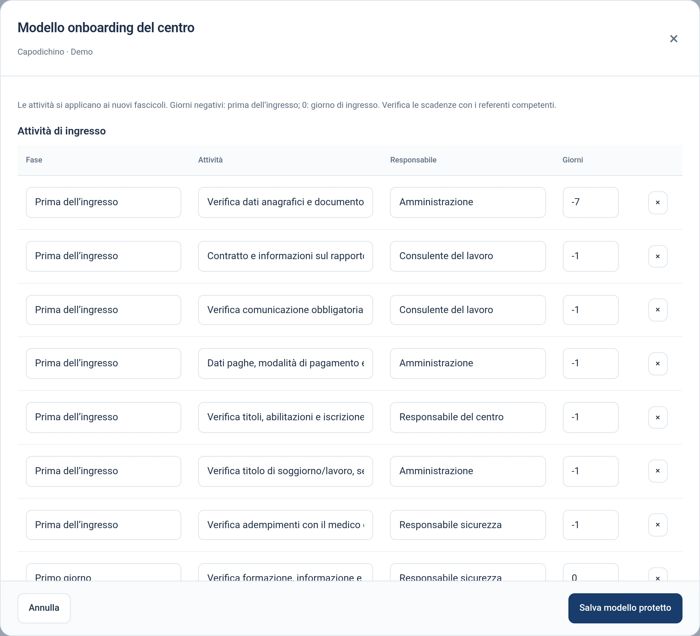

*Schermata dimostrativa del portale.*

1. Premi Modello onboarding. Controlla il centro indicato nella finestra.
2. Per ogni attività scegli fase, descrizione, responsabile e giorni rispetto all’ingresso: −7 indica una settimana prima, 0 il giorno d’ingresso.
3. Aggiungi o rimuovi le attività concordate. Il modello ammette da 1 a 80 compiti.
4. Aggiungi i campi personalizzati necessari, fino a 40: etichetta, tipo e indicazione Richiesto. Un campo richiesto vuoto viene segnalato ma non impedisce la bozza.
5. Premi Salva modello protetto. Al prossimo nuovo fascicolo controlla le attività e le scadenze generate.

**Esempio pratico:** Aggiungi “Conferma dotazione” con scadenza +3 giorni: un nuovo ingresso il 10 novembre riceverà l’attività con scadenza il 13 novembre.

**Risultato atteso:** I nuovi fascicoli usano il modello aggiornato; quelli esistenti mantengono le proprie attività e i valori già registrati.

**Problemi frequenti:**

- Versione cambiata: riapri il modello prima di ripetere la modifica.
- Attività vecchie non aggiornate: è previsto; modifica quelle necessarie nel singolo fascicolo.

### Impostazioni e campi

| Campo | Effetto | Esempio |
|---|---|---|
| Fase dell’attività | Raggruppa le attività del modello nel fascicolo. | Prima dell’ingresso. |
| Descrizione attività | Descrive in modo operativo ciò che occorre verificare. | Ricevere copia del contratto firmato. |
| Responsabile predefinito | Propone il referente nei nuovi fascicoli. | Amministrazione. |
| Giorni dall’ingresso | Intero da −365 a 730: genera la prima scadenza rispetto alla data d’ingresso. | −7: una settimana prima; 0: primo giorno; 30: dopo trenta giorni. |
| Etichetta campo personalizzato | Nome visibile del campo, fino a 100 caratteri. | Codice dotazione. |
| Tipo campo personalizzato | Testo, Data, Numero o Sì/No determina il controllo del valore. | Data per scadenza formazione interna. |
| Campo richiesto | Segnala l’incompletezza del fascicolo senza impedirne il salvataggio in bozza. | Attivo per un dato che l’ufficio deve ricevere. |
| Rimuovi definizione campo | Ritira il campo dal modello attivo senza cancellare valori storici già salvati. | Rimuovi una vecchia classificazione non più utilizzata. |

**Videoguida locale:** [video illustrato](assets/guides/modellohr.mp4) · [trascrizione](assets/guides/modellohr.txt)

## Personale di gruppo: collegare sedi e decorrenze

**A chi serve:** HR centrale e amministratori; funzioni di sede secondo autorizzazione

Riconoscere una stessa persona in più sedi e registrare condizioni valide da una data precisa.

**Prima di iniziare:**

- Verifica l’identità della persona prima di collegare due anagrafiche; nome o matricola uguali non bastano.
- Le operazioni disponibili dipendono dal ruolo e dall’accesso alle sedi interessate.

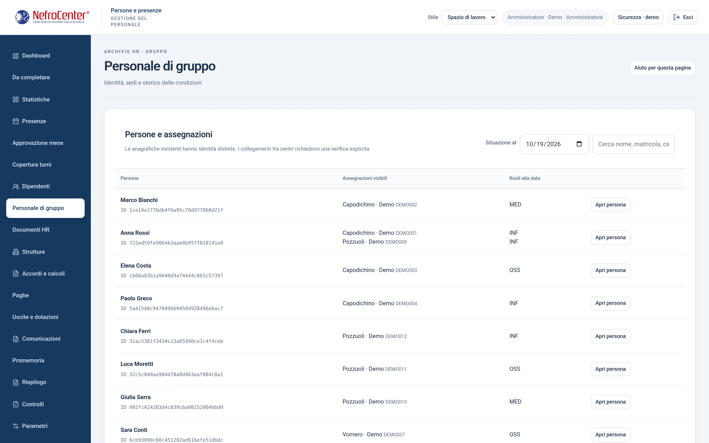

*Schermata dimostrativa del portale.*

1. Apri Personale di gruppo e cerca la persona. Controlla sedi, matricole e dati identificativi prima di intervenire.
2. Quando autorizzato, collega esplicitamente le anagrafiche alla stessa identità di gruppo e indica la motivazione. I fascicoli di sede rimangono distinti.
3. Apri lo storico contrattuale e registra decorrenza, eventuale termine e condizioni verificate: contratto, ore, part-time e qualifica.
4. Evita periodi sovrapposti: chiudi l’intervallo precedente e motiva eventuali correzioni. Controlla la situazione alla data di interesse.
5. Per le condizioni economiche usa lo storico e l’anteprima del mese. Applica soltanto dopo aver controllato i dati e le eventuali richieste di verifica manuale.
6. Riapri Accordi e calcoli per verificare il risultato del mese. Una variazione nello storico non riscrive da sola gli accordi già applicati.

**Esempio pratico:** Una persona opera in due sedi: colleghi le due anagrafiche dopo la verifica. I suoi turni possono così essere controllati per conflitti tra sedi.

**Risultato atteso:** Le sedi condividono un riferimento di identità verificato e lo storico conserva le decorrenze senza perdere i dati locali.

**Problemi frequenti:**

- Omonimia o identità incerta: non effettuare il collegamento finché i riferimenti non sono verificati.
- Periodi sovrapposti: correggi gli estremi prima di salvare.
- Variazione economica non applicabile automaticamente: segui la segnalazione dell’anteprima e verifica l’accordo mensile.

**Videoguida locale:** [video illustrato](assets/guides/personale.mp4) · [trascrizione](assets/guides/personale.txt)

## Documenti HR: controllare gli allegati delle sedi

**A chi serve:** HR centrale, amministratori e responsabili dei centri assegnati

Trovare i documenti ricevuti da remoto, aprirli e registrare il controllo HR.

**Prima di iniziare:**

- HR centrale e amministratori vedono tutte le sedi; i responsabili solo quelle assegnate.
- Compilatori e lettori non accedono all’archivio documentale HR.

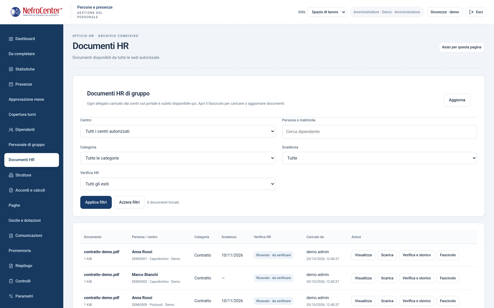

*Schermata dimostrativa del portale.*

1. Apri Documenti HR. Scegli una struttura oppure tutte quelle autorizzate.
2. Combina persona o matricola, categoria, scadenza e Verifica HR. Premi Applica filtri.
3. Controlla persona, sede, autore e data prima di premere Visualizza. Fascicolo apre la scheda per gestire rinnovi o nuovi allegati.
4. Apri Verifica e storico. HR o l’amministratore sceglie Conferma: verificato da HR oppure Richiedi una correzione, motiva e salva la verifica.
5. Filtra Da correggere per seguire le richieste aperte. Il responsabile può richiedere una nuova verifica dopo aver risolto il problema.
6. Usa Precedenti e Successivi per le pagine disponibili; Aggiorna rilegge i caricamenti remoti. Azzera filtri ripristina l’elenco autorizzato.

**Esempio pratico:** HR filtra una sede e Da correggere per preparare una verifica con il responsabile; ogni riga apre il documento e la motivazione registrata.

**Risultato atteso:** HR individua rapidamente file ricevuti, correzioni aperte e documenti già verificati, senza chiedere copie via email.

**Problemi frequenti:**

- File appena caricato non trovato: aggiorna, azzera i filtri e controlla sede e persona.
- Un file verificato può anche essere scaduto: esito HR e validità della data sono informazioni distinte.
- Versione cambiata: rileggi la decisione corrente prima di registrare un altro esito.

### Impostazioni e campi

| Campo | Effetto | Esempio |
|---|---|---|
| Verifica HR | Filtra per stato registrato oppure per scadenza calcolata. Verificati può includere file successivamente scaduti, evidenziati. | Scaduti, anche se già verificati. |

**Videoguida locale:** [video illustrato](assets/guides/hrcentrale.mp4) · [trascrizione](assets/guides/hrcentrale.txt)

## Accordi e calcoli: verificare il mese della persona

**A chi serve:** Responsabili autorizzati, HR centrale e amministratori secondo i permessi

Confermare il modello economico e le quantità pertinenti a una persona, una sede e un mese.

**Prima di iniziare:**

- Disponi dell’accordo reale verificato; i valori della demo non sono tariffe aziendali.
- La modifica manuale è riservata a responsabili e amministratori; HR centrale consulta e usa i percorsi autorizzati dello storico.

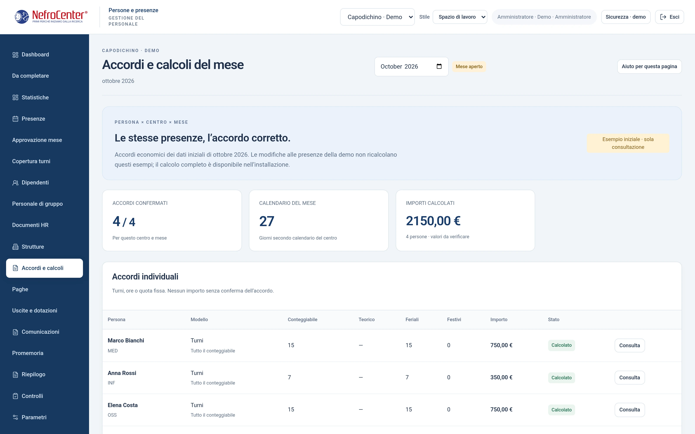

*Schermata dimostrativa del portale.*

1. Scegli centro e mese, poi premi Apri accordo sulla persona. Leggi origine dei valori, versione e avvisi.
2. Seleziona il modello Turni, Ore o Quota fissa e la base di conteggio prevista dall’accordo.
3. Imposta teorico, tariffe, quota fissa, detrazioni e rettifiche. Riferimento impostazioni descrive l’effetto di ogni campo.
4. Controlla le causali non lavorate incluse nel conteggiabile e la scelta sulle presenze fuori sede.
5. Dopo il confronto con l’accordo, spunta la verifica, inserisci una motivazione di almeno 8 caratteri e premi Salva accordo del mese.
6. Rileggi stato, quantità e importo. Se il risultato non è calcolabile, risolvi la segnalazione prima di utilizzarlo.

**Esempio pratico:** Un accordo a ore usa gli orari registrati: un turno con uscita mancante richiede una correzione, non una stima automatica.

**Risultato atteso:** La versione confermata riguarda solo la persona, il centro e il mese selezionati e resta nello storico.

**Problemi frequenti:**

- Tariffa a turno e tariffa oraria sono diverse: controlla l’unità prima di confermare.
- Mese chiuso o in approvazione: le modifiche sono bloccate fino al passaggio autorizzato.
- Un importo negativo resta una segnalazione da verificare; il software non esegue pagamenti.

### Impostazioni e campi

| Campo | Effetto | Esempio |
|---|---|---|
| Unità di calcolo | Sceglie turni/fasce, ore effettive e crediti oppure quota fissa; cambia il significato delle tariffe. | Ore: 6 ore × tariffa oraria. |
| Base di calcolo | Tutto il conteggiabile usa tutte le unità; meno teorico sottrae il teorico individuale. | 24 turni meno teorico 20 = 4 prima della ripartizione festivi. |
| Teorico individuale | Da calendario usa i giorni del centro; Valore individuale usa il numero inserito per questo mese. | Manuale per un ingresso a metà mese. |
| Teorico individuale, turni oppure ore | Numero usato quando il teorico è manuale; l’unità segue il modello. | 80 nel modello Ore significa 80 ore. |
| Ore teoriche per giorno | Nel modello Ore converte i giorni teorici del calendario in ore. | 6 ore × 20 giorni = 120 ore teoriche. |
| Tariffa feriale dell’accordo | Valore monetario per unità feriale; l’unità è turno o ora secondo il modello. | 15 €/ora nel modello Ore. |
| Tariffa festiva dell’accordo | Valore monetario per unità festiva riconosciuta. | 20 €/ora per le ore festive previste. |
| Detrazione fissa | Importo monetario sottratto dal risultato mensile. | −50,00 come effetto di una detrazione impostata a 50. |
| Quota fissa / integrazione | Importo aggiunto alle altre componenti, oppure base del modello Quota fissa. | 300,00 di integrazione confermata. |
| Rettifica positiva o negativa | Correzione monetaria esplicita con segno, motivata nello storico. | −25,00 rettifica in diminuzione. |
| Festivi già riconosciuti, numero | Numero intero moltiplicato per la rettifica unitaria da sottrarre. | 2 festivi già riconosciuti. |
| Rettifica per festivo già riconosciuto | Valore unitario sottratto per ciascun festivo già riconosciuto. | 2 × 10,00 = 20,00 sottratti. |
| Causali non lavorate nel conteggiabile | Include soltanto le causali selezionate; nel modello Ore usa il credito minuti configurato. | FER con credito 360 contribuisce sei ore se selezionata. |
| Includi le presenze fuori sede | Include nel conteggiabile dell’accordo le presenze esterne quando previsto. | Disattivo se la liquidazione spetta all’altra sede. |
| Conferma accordo, causali e calendario | Rende l’accordo confermato ai fini del calcolo, se i dati sono sufficienti. | Spunta solo dopo aver confrontato il mese con l’accordo firmato. |
| Motivazione della modifica | Testo di almeno 8 caratteri conservato per comprendere la variazione. | Accordo ottobre verificato con amministrazione. |

**Videoguida locale:** [video illustrato](assets/guides/accordi.mp4) · [trascrizione](assets/guides/accordi.txt)

## Riepilogo: controllare i totali e chiudere il mese

**A chi serve:** Consultazione secondo ruolo; chiusura ordinaria ai responsabili, approvazione finale HR quando il flusso è attivo

Riconciliare i totali e seguire il percorso di chiusura previsto dalla sede.

**Prima di iniziare:**

- Scegli centro e mese; distingui dati consuntivi e pianificati.
- Se il flusso approvazioni è attivo, la chiusura finale spetta a HR o all’amministratore.

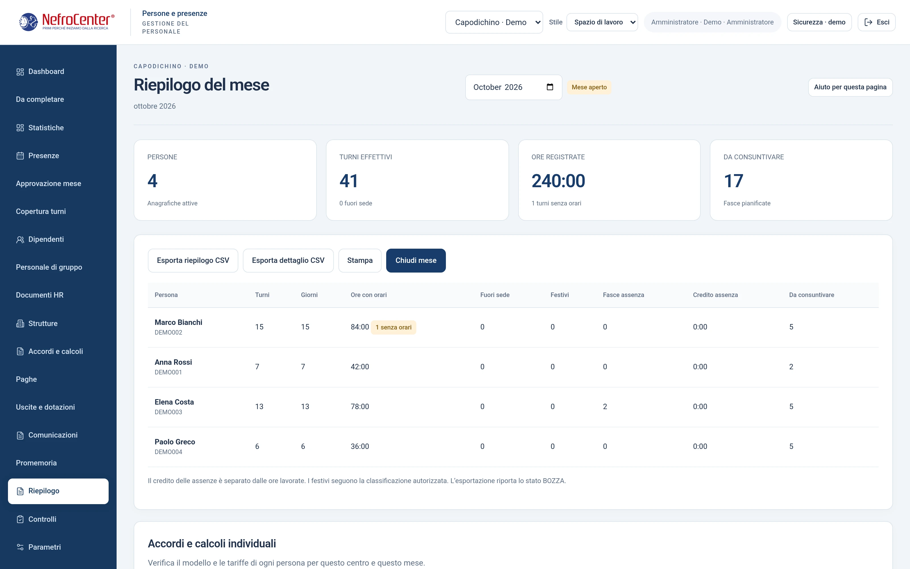

*Schermata dimostrativa del portale.*

1. Apri Riepilogo e confronta turni, giorni, ore note, fuori sede, festivi, assenze e crediti.
2. Controlla Da consuntivare e turni senza orari. Correggi nelle Presenze; se il mese è già inviato, richiedi prima una restituzione.
3. Quando autorizzato, usa Esporta riepilogo CSV, Esporta dettaglio CSV o Stampa. Il tracciato Paghe è un’esportazione distinta con controlli propri.
4. Con il flusso attivo, Chiudi mese porta ad Approvazione mese: segui invio della sede, verifica del responsabile e approvazione HR.
5. Con il flusso disattivato, il responsabile salva la verifica in Controlli, poi usa Chiudi mese. Per una correzione successiva usa Riapri mese e motiva.
6. Controlla lo stato Mese chiuso. Nel flusso attivo, una riapertura invalida l’approvazione e richiede di ripetere i passaggi.

**Esempio pratico:** Prima della chiusura trovi due fasce da consuntivare: chiedi conferma alla sede, completa le registrazioni reali e aggiorna i totali.

**Risultato atteso:** Il mese risulta chiuso e il registro è protetto dalle modifiche ordinarie.

**Problemi frequenti:**

- Chiusura bloccata: leggi la causa e completa consuntivi, orari richiesti o verifica del calendario.
- Mese già inviato: correggilo solo dopo la restituzione nel flusso di approvazione.
- Mese chiuso prima dell’attivazione: resta storico precedente e non riceve una verifica HR retroattiva.

**Videoguida locale:** [video illustrato](assets/guides/riepilogo.mp4) · [trascrizione](assets/guides/riepilogo.txt)

## Controlli: leggere anomalie e salvare la verifica

**A chi serve:** Tutti in consultazione secondo ruolo; verifica del mese ai responsabili

Verificare dati, calendario e parametri del mese lasciando un riferimento del controllo.

**Prima di iniziare:**

- Scegli la sede e il mese da controllare.
- Solo responsabili e amministratori salvano la verifica; gli altri ruoli consultano secondo i permessi.

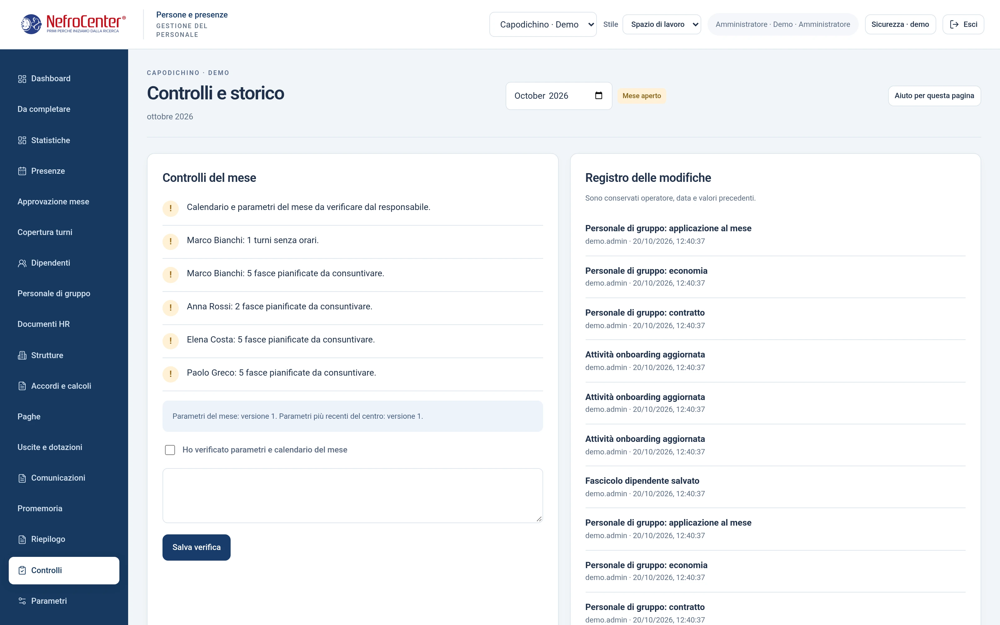

*Schermata dimostrativa del portale.*

1. Apri Controlli e leggi le segnalazioni una per una. Torna alla pagina di origine per correggere il dato.
2. Confronta la versione dei parametri del mese con quella corrente della sede: un mese compilato può conservare regole precedenti.
3. Quando il mese è modificabile, spunta Ho verificato parametri e calendario del mese. Inserisci una nota che indichi cosa hai controllato.
4. Premi Salva verifica e rileggi lo stato. Nel flusso approvazioni il responsabile può verificare il calendario anche durante il passaggio verso HR.
5. Consulta il registro per autore, data e operazione. Per la chiusura passa ad Approvazione mese, se attivo, oppure a Riepilogo.

**Esempio pratico:** Il responsabile confronta le festività del mese con il calendario autorizzato e annota il riferimento prima di salvare la verifica.

**Risultato atteso:** La verifica del calendario è registrata; non equivale da sola alla chiusura o all’approvazione finale HR.

**Problemi frequenti:**

- Mese inviato o chiuso: richiedi la restituzione o riapertura prima di modificare dati e verifica.
- Riferimenti cambiati dopo l’invio: avvia una nuova verifica tramite Approvazione mese.
- Una segnalazione organizzativa va valutata dal referente; non è di per sé una certificazione.

### Impostazioni e campi

| Campo | Effetto | Esempio |
|---|---|---|
| Ho verificato parametri e calendario | Registra la verifica del mese; non costituisce un flusso di invio/approvazione e non chiude il registro. | Spunta dopo aver confrontato festività e fasce. |
| Nota del mese | Conserva il riferimento del controllo organizzativo effettuato. | Calendario verificato con la sede il 30 novembre. |
| Motivo riapertura | Spiega la modifica a un mese precedentemente chiuso. | Correzione orario del 12 novembre autorizzata dal responsabile. |

**Videoguida locale:** [video illustrato](assets/guides/controlli.mp4) · [trascrizione](assets/guides/controlli.txt)

## Parametri: configurare fasce, causali e regole

**A chi serve:** Responsabili e amministratori abilitati; altri ruoli in lettura

Cambiare le regole della sede sapendo quali dati risentono subito della modifica e quali conservano una versione mensile.

**Prima di iniziare:**

- Modifiche riservate a responsabili e amministratori nel proprio ambito.
- Concorda le regole prima di salvarle e controlla sede e mese.

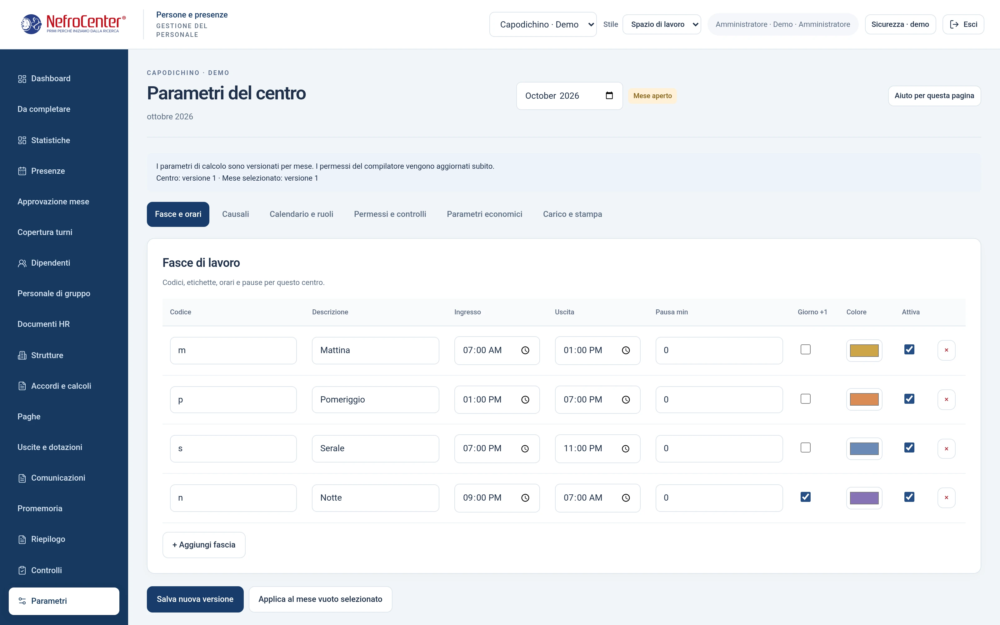

*Schermata dimostrativa del portale.*

1. Apri Parametri e confronta la versione corrente del centro con quella del mese.
2. In Fasce e orari definisci orari, pausa e passaggio al giorno successivo. In Causali controlla tipo, stato Attiva e fasce autorizzate.
3. In Calendario e ruoli imposta apertura, festività, qualifiche e sedi esterne. In Permessi e controlli scegli le azioni ammesse al compilatore.
4. In Parametri economici imposta le proposte per i nuovi accordi. In Carico e stampa completa i riferimenti organizzativi e il separatore CSV.
5. Usa Riferimento impostazioni per capire ogni campo; premi Salva nuova versione dopo la verifica. I permessi del compilatore entrano in vigore subito.
6. Per aggiornare le regole di un periodo idoneo usa Applica al mese vuoto selezionato e motiva. Un mese già compilato conserva le proprie regole.

**Esempio pratico:** Aggiungi una nuova fascia serale: controlla orari, causale di lavoro e fasce ammesse prima di usarla in un mese nuovo.

**Risultato atteso:** La nuova configurazione è versionata; gli accordi già salvati non cambiano automaticamente.

**Problemi frequenti:**

- Causale assente nel registro: verifica Attiva e Fasce autorizzate.
- Tariffa precedente nell’accordo: modifica e conferma l’accordo del mese; i valori iniziali non lo riscrivono.
- Pausa o turno notturno incoerenti: correggi orari, minuti di pausa e Giorno +1.

### Impostazioni e campi

| Campo | Effetto | Esempio |
|---|---|---|
| Codice fascia | Identifica la fascia nel registro e nei vincoli delle causali. Scegli un codice distinto e stabile. | M per Mattina; N per Notte. |
| Descrizione fascia | Mostra il nome leggibile della fascia nei selettori e nella legenda. | Mattina. |
| Ingresso della fascia | Propone l’inizio standard per le nuove registrazioni che usano questa fascia. | 08:00. |
| Uscita della fascia | Propone l’uscita standard; per un orario oltre mezzanotte serve Giorno +1. | 14:00, oppure 06:00 con ingresso 22:00 e Giorno +1. |
| Pausa in minuti | Sottrae i minuti di pausa dalla durata del lavoro; deve essere coerente con la fascia. | 30 trasforma 08:00–14:00 in 5 ore e 30 minuti. |
| Giorno +1 | Indica che l’uscita appartiene al giorno successivo all’ingresso. | Attivo per 22:00–06:00. |
| Colore fascia | Aiuta a riconoscere visivamente la fascia; non modifica i conteggi. | Blu per Mattina. |
| Fascia attiva | Rende la fascia disponibile alle nuove registrazioni; lo storico resta consultabile. | Disattiva una fascia che non si usa più dopo aver verificato le causali. |
| Aggiungi fascia | Crea una fascia e una causale lavoro iniziale associata; completa entrambi i codici prima di salvare. | Crea SERA, poi verifica orario e causale. |
| Rimuovi fascia | Rimuove la riga dalla nuova configurazione; preferisci disattivare quando il codice è già stato usato. | Rimuovi una riga appena creata per errore. |
| Codice causale | Identifica il tipo di registrazione nelle celle e nelle esportazioni. | FER per ferie. |
| Descrizione causale | Spiega il significato del codice in legenda e selezione. | Ferie autorizzate. |
| Tipo causale | Distingue Lavoro, Assenza e Riposo; determina a quali conteggi contribuisce la registrazione. | FER → Assenza; RIP → Riposo. |
| Fasce autorizzate | Limita l’uso della causale ai codici fascia elencati, separati da virgole; vuoto significa tutte. | M,P consente mattina e pomeriggio. |
| Credito minuti dell’assenza | Attribuisce un credito separato dalle ore effettivamente lavorate; entra nel modello ore solo quando l’accordo include quella causale. | 360 per un credito di sei ore, se previsto dall’accordo. |
| Colore causale | Colora il riferimento visivo della causale senza modificarne natura e conteggio. | Arancione per FER. |
| Causale attiva | Consente di scegliere la causale per nuove registrazioni. Le registrazioni storiche non scompaiono. | Disattiva una causale sostituita dal nuovo modello. |
| Aggiungi causale | Aggiunge una riga da completare con codice, descrizione, tipo e fasce ammesse. | Aggiungi FOR per formazione lavorativa secondo le regole aziendali. |
| Rimuovi causale | Toglie la definizione dalla nuova versione; valuta la disattivazione per codici usati nello storico. | Elimina soltanto una causale creata per errore. |
| Giorni della settimana | Definisce i giorni del calendario lavorativo teorico del centro. | Lunedì–sabato, domenica esclusa. |
| Festività | Elenca una data AAAA-MM-GG per riga; incide sul calendario autorizzato del centro. | 2026-12-25. |
| Ruoli | Definisce le qualifiche selezionabili nelle anagrafiche del centro; una voce per riga. | Infermiere, Medico, Amministrativo. |
| Sedi esterne autorizzate | Definisce le destinazioni selezionabili per il lavoro fuori sede. | Centro A; Centro B su righe distinte. |
| Note e accordi del centro | Conserva una spiegazione amministrativa della configurazione; non è una formula di calcolo. | Calendario validato il 18/10/2026 dal responsabile. |
| Può inserire orari effettivi e pause | Abilita il compilatore a correggere ingresso, uscita e pausa; il permesso cambia subito. | Attivalo se la sede rileva gli orari effettivi. |
| Può scegliere una sede esterna autorizzata | Permette al compilatore di selezionare una delle sedi configurate. | Attivalo per chi registra sostituzioni fra centri. |
| Può classificare manualmente un festivo | Permette la classificazione manuale del festivo nelle registrazioni, secondo la verifica aziendale. | Lascialo disattivato se la classificazione è riservata al responsabile. |
| Può eliminare una registrazione | Consente al compilatore la rimozione di una cella registrata, con controllo dei permessi sul server. | Attivalo per correggere duplicati operativi. |
| Può esportare i riepiloghi | Abilita le esportazioni presenze consentite al compilatore; non concede accesso ai fascicoli HR. | Attivalo per inviare il riepilogo autorizzato della sede. |
| Può compilare la pianificazione | Consente la scrittura nel registro Pianificato. | Attivalo per l’operatore che prepara i turni. |
| Intervallo minimo tra turni, ore | Imposta la soglia di segnalazione organizzativa per l’intervallo tra turni, fra 0 e 48 ore. | 11 segnala intervalli inferiori a undici ore. |
| Richiedi orari completi prima della chiusura | Blocca la chiusura quando mancano gli orari necessari dei turni lavorativi. | Attivo richiede di completare 08:00–14:00 prima della chiusura. |
| Tariffa feriale iniziale | Propone la tariffa feriale per i nuovi accordi da confermare; non riscrive gli accordi salvati. | 20,00 da verificare rispetto a €/ora o €/turno. |
| Tariffa festiva iniziale | Propone il valore festivo dei nuovi accordi. | 30,00 secondo l’unità e l’accordo. |
| Detrazione fissa iniziale | Propone una sottrazione monetaria nei nuovi accordi, da verificare individualmente. | 50,00 se previsto dall’accordo. |
| Rettifica festivo già riconosciuto | Memorizza il riferimento del centro; le rettifiche dei nuovi accordi partono da zero e vanno impostate individualmente. | Verifica e inserisci nell’accordo persona/mese una rettifica di 10,00 quando dovuta. |
| Base del conteggio iniziale | Propone Tutto il conteggiabile oppure Totale meno teorico ai nuovi accordi. | Totale 24 e teorico 20 → base extra 4 prima delle altre componenti. |
| Ruoli infermieristici | Identifica quali ruoli delle presenze entrano nel denominatore infermieristico del carico. | Infermiere, una voce esatta per riga. |
| Ruoli medici | Identifica i ruoli che entrano nel denominatore medico del carico. | Medico. |
| Riferimento pazienti/infermiere | Valore organizzativo positivo usato come confronto per l’indice INF. | 4 significa confronto con quattro pazienti per infermiere, da validare. |
| Riferimento pazienti/medico | Valore organizzativo positivo per l’indice MED. | 12 come riferimento aziendale esemplificativo. |
| Peso contumacia, infermieri | Pesa i pazienti in contumacia nel rapporto infermieristico; non certifica fabbisogni clinici. | 1,5 attribuisce peso maggiore di un paziente ordinario. |
| Separatore CSV | Sceglie punto e virgola, virgola o tabulazione per i CSV gestiti da questo parametro. | Punto e virgola per un importatore che lo richiede. |
| Salva nuova versione | Registra la configurazione del centro; i mesi compilati conservano le regole già associate. | Modifica a ottobre senza riscrivere settembre. |
| Applica al mese vuoto selezionato | Associa la configurazione recente a un mese vuoto quando consentito dal servizio. | Prepara novembre prima della prima registrazione. |

**Videoguida locale:** [video illustrato](assets/guides/parametri.mp4) · [trascrizione](assets/guides/parametri.txt)

## Centri: creare una sede o importare il modello

**A chi serve:** Tutti vedono i centri assegnati; creazione e importazione agli amministratori

Aggiungere una sede separata e controllare i dati prima della prima compilazione.

**Prima di iniziare:**

- Creazione centri e importazione sono riservate agli amministratori.
- Per importare serve un modello Excel compatibile entro 12 MB, non un foglio generico.

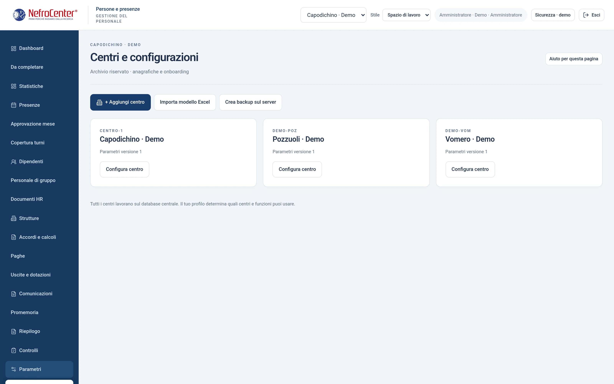

*Schermata dimostrativa del portale.*

1. Apri Centri. Per lavorare su una sede esistente usa il suo pulsante di apertura.
2. Per una sede nuova premi Aggiungi centro, inserisci nome e codice univoco e scegli i valori iniziali o una configurazione da copiare.
3. Controlla fasce, causali, calendario e ruoli copiati prima della compilazione. La copia della configurazione non è una copia dei dipendenti.
4. Per il modello compatibile premi Importa modello Excel. Leggi l’anteprima: centro, mese, persone e avvisi.
5. Conferma soltanto dopo il confronto. L’importazione crea un centro separato ed è preceduta da backup; non modifica il file originale.
6. Assegna la sede ai relativi account in Utenti e permessi.

**Esempio pratico:** Per aprire una sede con fasce simili a un’altra, copi la configurazione iniziale e poi verifichi festività e recapiti propri.

**Risultato atteso:** La nuova sede è presente nell’archivio centrale e può essere assegnata agli utenti.

**Problemi frequenti:**

- Codice già usato: scegli quello corretto e univoco del centro.
- Excel rifiutato o avvisi inattesi: interrompi la conferma e verifica il modello di origine.
- Non ripetere un’importazione per correggere il centro già creato: prima controlla l’esito della precedente.

### Impostazioni e campi

| Campo | Effetto | Esempio |
|---|---|---|
| Nome struttura | Etichetta del centro mostrata nelle pagine e nei report. | Centro Esempio. |
| Codice centro | Identificativo amministrativo distinto del centro. | ESEMPIO01. |
| Configurazione iniziale | Copia regole iniziali da un centro esistente oppure usa valori da verificare. | Copia Centro A, poi adatta le festività locali. |
| Stile interfaccia | Cambia la presentazione grafica sul browser; non modifica presenze, permessi o calcoli. | Attuale, Editoriale, Essenziale o Spazio di lavoro. |

**Videoguida locale:** [video illustrato](assets/guides/centri.mp4) · [trascrizione](assets/guides/centri.txt)

## Statistiche: confrontare dati completi e dati mancanti

**A chi serve:** Account autorizzati; contenuti HR solo ai ruoli abilitati

Confrontare periodi e sedi usando gli stessi filtri e leggendo prima la qualità dei dati.

**Prima di iniziare:**

- Decidi quale periodo e quali sedi confrontare.
- Le statistiche HR richiedono un ruolo autorizzato e descrivono la situazione attuale.

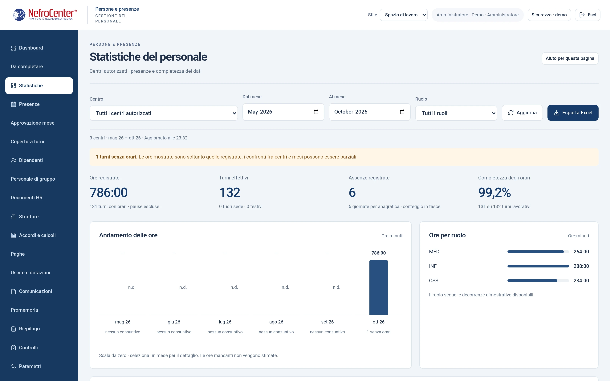

*Schermata dimostrativa del portale.*

1. Apri Statistiche. Seleziona un centro o il gruppo autorizzato e un intervallo Dal mese / Al mese entro 24 mesi.
2. Se serve, filtra la qualifica e, per un singolo centro, la persona. Aggiorna il confronto.
3. Controlla prima completezza degli orari e mesi senza dati. Le ore non disponibili non vengono stimate.
4. Leggi ore note, turni, fasce di assenza e fuori sede. Seleziona un mese o un centro per approfondire e apri il registro dal dettaglio persona.
5. Esporta Excel quando disponibile: nell’installazione operativa segue filtri e permessi della pagina. Nella demo gli Excel sono esempi sul campione iniziale.

**Esempio pratico:** Confronta settembre e ottobre dello stesso centro: prima della variazione delle ore controlla se entrambi i mesi hanno gli orari completi.

**Risultato atteso:** Il confronto conserva un perimetro chiaro e rende distinguibili valori registrati e informazioni mancanti.

**Problemi frequenti:**

- Quota assenze: è riferita alle fasce registrate, non a ore contrattuali, saldo ferie o tasso ufficiale di assenteismo.
- Qualifica storica: il sistema usa le decorrenze disponibili; dove mancano, non ricostruisce un ruolo passato presunto.
- La stessa persona in più sedi può comparire più volte nei dettagli per centro; controlla il livello del prospetto.

### Impostazioni e campi

| Campo | Effetto | Esempio |
|---|---|---|
| Centro statistiche | Seleziona un centro o tutti quelli autorizzati; il filtro persona richiede una sede singola. | Tutti i centri autorizzati. |
| Dal mese | Inizio del periodo di confronto, incluso. | 2026-01. |
| Al mese | Fine inclusa del periodo; l’intervallo ammesso arriva a 24 mesi. | 2026-12. |
| Ruolo statistiche | Filtra per ruolo attuale dell’anagrafica. | Infermiere. |
| Persona statistiche | Limita i risultati all’anagrafica del centro scelto. | Anna Esempio nel Centro A. |

**Videoguida locale:** [video illustrato](assets/guides/statistiche.mp4) · [trascrizione](assets/guides/statistiche.txt)

## Backup ed esportazioni: scegliere il file corretto

**A chi serve:** Excel secondo i permessi; gestione backup riservata agli amministratori

Scaricare il prospetto richiesto e distinguere un’esportazione da una copia completa dell’archivio.

**Prima di iniziare:**

- Le esportazioni dipendono dai permessi; i backup sono riservati all’amministratore.
- Per la seconda copia serve una cartella NAS o destinazione separata raggiungibile dal servizio.

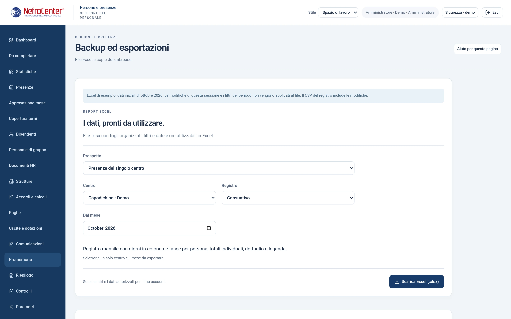

*Schermata dimostrativa del portale.*

1. Apri Backup ed esportazioni e scegli Prospetto: registro, presenze complessive, statistiche, fascicoli, onboarding/scadenze oppure accordi.
2. Imposta i filtri richiesti. Il registro usa un centro, un mese e Pianificato o Consuntivo; i prospetti HR descrivono la situazione attuale.
3. Premi Scarica Excel e controlla nome e contenuto del file. Per dati riservati può essere richiesta una nuova verifica di sicurezza.
4. Come amministratore, configura destinazione separata, conservazione e frequenza delle prove. Il database attivo deve restare sul disco locale del server.
5. Crea backup adesso, poi usa Copia e prova ripristino per verificare anche la destinazione separata. Controlla data, esito ed eventuali errori.
6. Custodisci separatamente la chiave 2FA e pianifica un ripristino completo di prova seguendo INSTALLAZIONE_WEB.md.

**Esempio pratico:** Per il consulente interno scarichi un prospetto Excel; per recuperare il sistema dopo un guasto servono invece backup del database e chiave privata.

**Risultato atteso:** Il prospetto contiene i dati richiesti; il backup completo conserva anche i documenti, con esiti di verifica consultabili.

**Problemi frequenti:**

- Excel non è un backup: non include i file allegati binari né l’intera configurazione.
- Copia NAS non riuscita: verifica percorso montato, permessi dell’account del servizio e spazio.
- La prova tecnica del backup non sostituisce il collaudo di accessi e documenti su un ambiente di ripristino.

### Impostazioni e campi

| Campo | Effetto | Esempio |
|---|---|---|
| Prospetto Excel | Sceglie registro, totali, statistiche, fascicoli, onboarding o accordi; i permessi limitano le opzioni. | Onboarding e scadenze per l’inventario HR. |
| Centro esportazione | Sceglie il perimetro; il registro mensile richiede un solo centro. | Centro A per Presenze del singolo centro. |
| Registro esportato | Per il registro mensile distingue Pianificato e Consuntivo. | Consuntivo per quanto svolto. |
| Dal mese esportazione | Primo mese o mese unico del registro; non si applica alla fotografia HR attuale. | 2026-11. |
| Al mese esportazione | Ultimo mese dei prospetti di periodo, entro 24 mesi. | 2026-12. |

**Videoguida locale:** [video illustrato](assets/guides/esportazioni.mp4) · [trascrizione](assets/guides/esportazioni.txt)

## Paghe: preparare e verificare il tracciato

**A chi serve:** HR centrale, amministratori e responsabili autorizzati

Produrre un file coerente con le specifiche ricevute dal consulente, senza presumere un gestionale destinatario.

**Prima di iniziare:**

- Finché il fornitore non è noto, conserva Modello generico in bozza.
- Chiedi un esempio vuoto e le specifiche: intestazioni, causali, matricole, date, separatori e codifica.

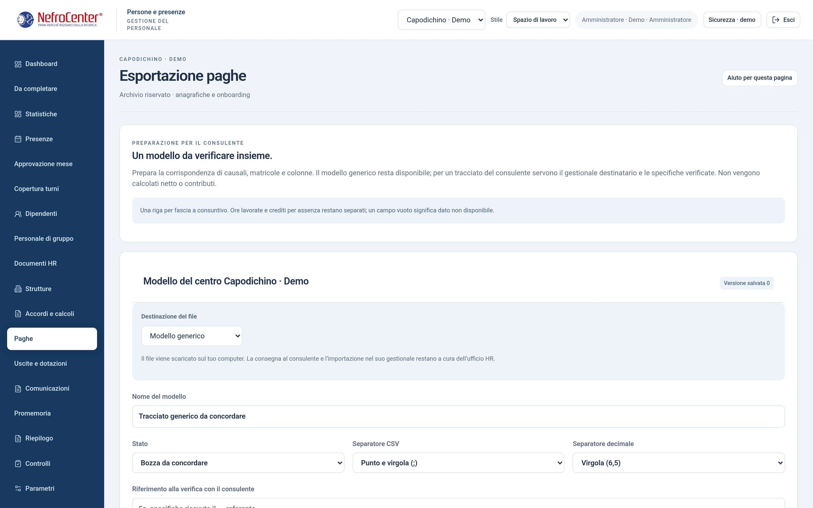

*Schermata dimostrativa del portale.*

1. Apri Paghe nel centro corretto. Per usare le specifiche ricevute scegli Tracciato del consulente e indica gestionale, nome, versione e riferimento del formato.
2. Apri Leggi le intestazioni o un file di specifiche. Incolla solo la riga delle intestazioni CSV, oppure carica un file UTF-8 fino a 32 KiB; è ammessa anche la specifica JSON esportata dal portale.
3. Premi Leggi e prepara la bozza. Controlla ogni associazione, ordine, tipo, obbligatorietà e lunghezza; le intestazioni sconosciute restano Da associare. Il modello salvato cambia solo quando lo salvi.
4. Completa separatori, formato data, codifica, codici delle causali e matricole alternative, se necessarie. Salva prima in bozza.
5. Dopo la verifica con il consulente scegli Verificato con il consulente, indica il riferimento e conferma esplicitamente. Una modifica successiva richiede una nuova conferma.
6. Genera l’anteprima per il periodo scelto. Risolvi i blocchi su orari, matricole, causali e colonne; con il flusso attivo, ogni mese deve avere un’approvazione HR corrente.
7. Controlla quantità e formato, poi scarica CSV o Excel. Se dati o modello cambiano, rigenera l’anteprima. Collauda il file nell’importatore reale del consulente.
8. Per condividere soltanto il formato usa Scarica le specifiche salvate: il JSON non contiene presenze o matricole personali.

**Esempio pratico:** Il consulente richiede Matricola;Data;Causale;Ore: importi la sola intestazione, associ le quattro colonne e verifichi formato data e decimali prima del file pilota.

**Risultato atteso:** Hai un file locale controllato rispetto al modello configurato, da collaudare e consegnare tramite i canali aziendali.

**Problemi frequenti:**

- Righe dei dipendenti nel file intestazioni: rimuovile e lascia soltanto la prima riga.
- Gestionale o specifica incompleti: mantieni la bozza; non è dichiarata una compatibilità certificata.
- Colonna non associata o carattere non rappresentabile: correggi mappatura o dato secondo la specifica concordata.
- Tracciati a larghezza fissa o campi non disponibili richiedono un adattamento dedicato. Il portale non produce cedolini né invia il file automaticamente.

### Impostazioni e campi

| Campo | Effetto | Esempio |
|---|---|---|
| Destinazione del file | Distingue un modello generico dalle specifiche di un consulente; il cambio riporta il modello in bozza. | Tracciato del consulente. |
| Gestionale destinatario | Nome del gestionale comunicato dal consulente; obbligatorio per confermare il suo tracciato. | Nome effettivo del prodotto, quando comunicato. |
| Nome tracciato | Identifica il formato di importazione concordato. | Presenze giornaliere. |
| Versione specifiche | Versione della specifica esterna; distinta dalla versione interna del modello. | 2026.10. |
| Riferimento alle specifiche | Documento e data che attestano il formato richiesto. | Istruzioni ricevute il 20/10/2026. |
| Nome modello | Etichetta del modello del centro. Ogni salvataggio crea una nuova versione. | Presenze centro Alfa. |
| Stato del modello | Una bozza produce anteprime ma non consente il download operativo. | Bozza da concordare. |
| Riferimento alla verifica | Nota di almeno 8 caratteri sulla verifica col consulente; obbligatoria per confermare. | Specifiche verificate con il referente il 20/10. |
| Conferma esplicita della versione | Attesta la verifica di questa versione; si azzera dopo ogni modifica locale. | Seleziona solo dopo aver controllato intestazioni e formato. |
| Separatore CSV | Carattere che divide i campi nel file prodotto. | Punto e virgola, virgola o tabulazione. |
| Separatore decimale | Rappresentazione delle quantità decimali nel CSV e nell’anteprima. | 6,5 ore oppure 6.5 ore. |
| Formato date | Formato delle date esportate nel CSV; Excel conserva celle data. | GG/MM/AAAA. |
| Codifica CSV | UTF-8 con BOM, UTF-8 o Windows-1252; caratteri non compatibili bloccano il tracciato consulente. | UTF-8 con BOM, se concordato. |
| Contenuto delle specifiche | Legge una sola intestazione CSV o il formato JSON esportato dal software. Non importa presenze. | Sola intestazione CSV. |
| Separatore intestazioni | Separatore del testo che si sta leggendo; viene proposto anche per il modello importato. | Punto e virgola. |
| File delle specifiche | File UTF-8 massimo 32 KiB, senza righe di dati dei dipendenti. | File CSV con la sola prima riga. |
| Dato del registro | Associa un dato a ogni intestazione. Matricola, data e causale paghe devono essere presenti. | MATR → Matricola paghe. |
| Intestazione e ordine | Definisce nomi e sequenza esatti delle colonne; frecce su e giù spostano anche le loro regole. | MATR;GIORNO;CAUSALE;ORE. |
| Tipo della colonna | Richiede testo, intero, decimale o data. Il dato associato deve essere compatibile. | Ore lavorate decimali → Decimale. |
| Colonna obbligatoria | Un valore vuoto blocca il download se la colonna è obbligatoria. | Ore facoltative per righe di assenza. |
| Massimo caratteri | Limita la lunghezza del valore formattato; vuoto significa nessun limite aggiuntivo. | Matricola massimo 12 caratteri. |
| Corrispondenza causali | Codice paghe per ogni causale presente nei consuntivi. | Mattina → codice ordinario indicato dal consulente. |
| Matricole alternative | Codice personale limitato al modello di questo centro. Se vuoto usa l’anagrafica. | 00017 resta testo e mantiene gli zeri iniziali. |
| Periodo dell’anteprima | Mese iniziale e finale inclusi, massimo 24 mesi; cambiare periodo invalida l’anteprima. | Ottobre–dicembre 2026. |
| Scarica le specifiche salvate | Esporta solo regole di formato e associazioni delle colonne, senza dati personali o causali/matricole individuali. | JSON da far verificare al consulente. |

**Videoguida locale:** [video illustrato](assets/guides/paghe.mp4) · [trascrizione](assets/guides/paghe.txt)

## Utenti e permessi: assegnare il ruolo corretto

**A chi serve:** Solo amministratori

Creare un account nominativo con il ruolo e le sedi necessari al lavoro della persona.

**Prima di iniziare:**

- Operazione riservata agli amministratori.
- Concorda ruolo e sedi prima della creazione; non usare un account condiviso.

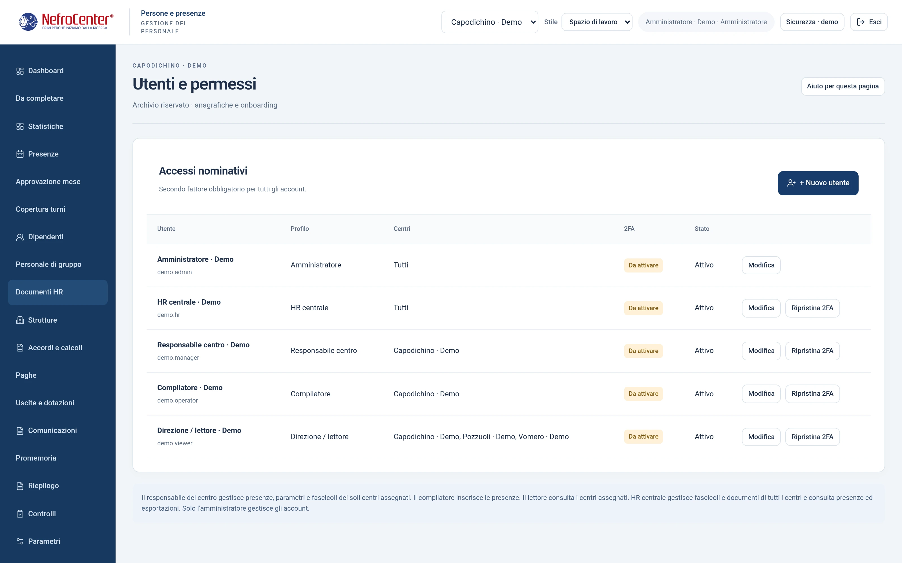

*Schermata dimostrativa del portale.*

1. Apri Utenti e permessi e premi Nuovo utente. Inserisci nome, nome utente e password iniziale di almeno 12 caratteri.
2. Scegli il ruolo: Compilatore per il registro, Lettore per consultazione, Responsabile per la sede, HR centrale per processi HR di gruppo, Amministratore per configurazione e account.
3. Assegna i centri ai ruoli di sede. HR centrale e amministratore hanno ambito globale; l’utente Lettore non riceve automaticamente tutte le sedi.
4. Salva e conserva il codice di attivazione mostrato, valido 7 giorni. Consegnalo riservatamente alla persona, separato dalla password.
5. Per revocare l’accesso togli Account attivo e salva. Le modifiche all’account revocano le sessioni.
6. Per un telefono perso, verifica l’identità prima di usare Ripristina 2FA con motivazione. Il vecchio dispositivo, i recuperi e le sessioni vengono revocati.

**Esempio pratico:** Un referente HR che deve leggere documenti di tutte le sedi riceve HR centrale; non serve assegnargli Amministratore per questo compito.

**Risultato atteso:** L’utente accede con credenziali proprie e trova le funzioni e le sedi assegnate.

**Problemi frequenti:**

- Il codice non viene inviato automaticamente via email: consegnalo con il canale aziendale previsto.
- Cambiare la password dall’amministrazione non disabilita il secondo fattore.
- Il percorso Uscite registra le attività, ma non disabilita da solo gli account: completa anche questa operazione.

### Impostazioni e campi

| Campo | Effetto | Esempio |
|---|---|---|
| Nome dell’utente | Nome leggibile nelle operazioni e nella gestione degli account. | Referente Sede A. |
| Nome utente | Identificativo personale di accesso; distinto dal nome del dipendente. | m.rossi. |
| Profilo | Definisce azioni e dati accessibili; assegnare HR centrale per consultare fascicoli di tutte le sedi senza gestione degli account. | Compilatore per inserimento presenze. |
| Password iniziale / nuova password | Per un nuovo account almeno 12 caratteri; in modifica il campo vuoto conserva la password. | Una frase personale robusta, fornita con canale riservato. |
| Centri assegnati | Limita i ruoli di sede ai centri selezionati; amministratore e HR centrale hanno il perimetro globale previsto dal loro ruolo. | Solo Centro A per il suo compilatore. |
| Account attivo | Abilita l’accesso; disattivarlo revoca le sessioni. | Disattivo quando termina l’incarico. |
| Motivo del ripristino 2FA | Registra il riferimento della verifica di identità prima di generare una nuova attivazione. | Telefono sostituito, identità verificata dal referente. |

**Videoguida locale:** [video illustrato](assets/guides/utenti.mp4) · [trascrizione](assets/guides/utenti.txt)

## Sicurezza: gestire telefono, recuperi e sessioni

**A chi serve:** Ogni utente gestisce il proprio account

Mantenere un modo affidabile per accedere e revocare le sessioni non più necessarie.

**Prima di iniziare:**

- Apri il tuo account da Sicurezza · 2FA.
- Prima di cambiare telefono assicurati di avere accesso al dispositivo attuale o ai codici di recupero.

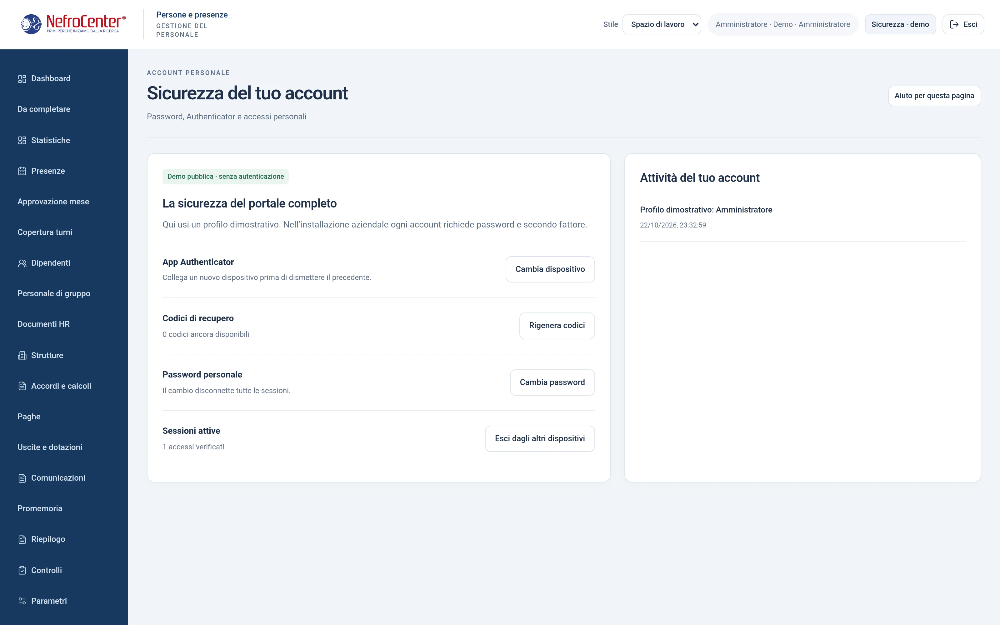

*Schermata dimostrativa del portale.*

1. Controlla attività recenti, sessioni e numero di codici di recupero disponibili.
2. Per sostituire il telefono premi Cambia dispositivo, collega il nuovo Authenticator e conferma il codice prima di dismettere il vecchio.
3. Rigenera codici sostituisce i precedenti: conserva la nuova serie in un luogo riservato e separato dal telefono.
4. Per Cambia password inserisci quella attuale e ripeti la nuova, di almeno 12 caratteri. Il cambio disconnette le sessioni.
5. Usa Esci dagli altri dispositivi per revocare le altre sessioni; Esci nell’intestazione termina quella corrente.

**Esempio pratico:** Prima di consegnare il vecchio telefono, colleghi e verifichi quello nuovo e conservi i nuovi codici di recupero.

**Risultato atteso:** I dispositivi e le sessioni rimasti validi sono quelli che intendi usare; i nuovi recuperi sono disponibili se necessari.

**Problemi frequenti:**

- Telefono perso: usa password e un recupero monouso, oppure chiedi il ripristino al referente dopo verifica d’identità.
- Password dimenticata: segui il recupero previsto dall’azienda; non esiste una password universale.
- Conferma di sicurezza richiesta: ripeti password e codice personale per l’operazione riservata.

### Impostazioni e campi

| Campo | Effetto | Esempio |
|---|---|---|
| Password attuale | Conferma l’identità nel cambio password e nelle operazioni protette. | Inserisci la password personale attuale. |
| Nuova password | Password personale di almeno 12 caratteri, da ripetere identica. | Usa una frase unica per questo portale. |
| Codice Authenticator | Codice TOTP a sei cifre generato dall’app; dipende dall’orologio del dispositivo. | Usa il codice corrente prima della scadenza. |
| Codice di recupero | Alternativa monouso al TOTP quando selezioni l’opzione corrispondente. | Usa uno dei codici conservati separatamente dal telefono. |
| Cambia dispositivo | Collega un nuovo Authenticator con conferma del codice e nuovi recuperi. | Effettua il passaggio prima di dismettere il vecchio telefono. |
| Rigenera codici | Revoca i vecchi codici e genera una nuova serie visibile una volta sola. | Scarica e custodisci subito la nuova serie. |
| Esci dagli altri dispositivi | Revoca le sessioni diverse da quella corrente. | Chiudi l’accesso lasciato su una postazione condivisa. |

**Videoguida locale:** [video illustrato](assets/guides/sicurezza.mp4) · [trascrizione](assets/guides/sicurezza.txt)

## Carico: registrare i totali per fascia

**A chi serve:** Responsabili e amministratori abilitati

Registrare conteggi aggregati dei pazienti e leggere i rapporti organizzativi della sede.

**Prima di iniziare:**

- Modifica riservata a responsabili e amministratori.
- Il mese deve essere modificabile; usa soltanto conteggi aggregati, senza dati identificativi dei pazienti.

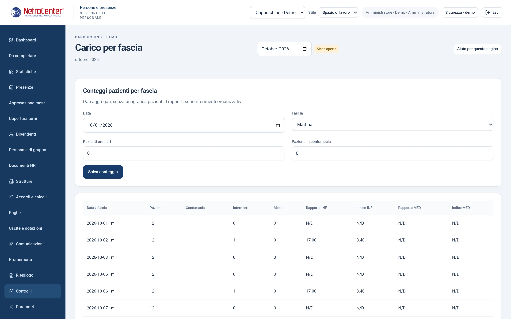

*Schermata dimostrativa del portale.*

1. Apri Carico e controlla centro, mese, data e fascia.
2. Inserisci il numero di pazienti ordinari e in contumacia, usando interi non negativi.
3. Premi Salva conteggio e verifica la riga della data e fascia selezionate.
4. Leggi rapporti INF/MED e indici rispetto ai parametri della sede. Il personale pertinente deriva dalle presenze e dai ruoli configurati.
5. Se compare N/D, controlla dati e configurazione senza sostituirlo con zero. I risultati vanno valutati dai referenti.

**Esempio pratico:** Per la mattina registri 18 pazienti ordinari e 2 in contumacia: la tabella usa il peso configurato per il riferimento infermieristico.

**Risultato atteso:** La tabella conserva un riferimento organizzativo per data e fascia, distinto dalle informazioni cliniche.

**Problemi frequenti:**

- N/D: può mancare personale pertinente o un conteggio; verifica la fonte.
- I rapporti non certificano adeguatezza clinica o conformità normativa.
- Mese inviato o chiuso: serve il passaggio autorizzato prima di modificare il conteggio.

### Impostazioni e campi

| Campo | Effetto | Esempio |
|---|---|---|
| Data conteggio | Data della rilevazione nel mese selezionato. | 2026-11-12. |
| Fascia conteggio | Fascia cui si riferiscono pazienti e personale di confronto. | Mattina. |
| Pazienti ordinari | Numero intero non negativo, senza anagrafiche cliniche. | 18. |
| Pazienti in contumacia | Numero intero non negativo, pesato nel riferimento infermieristico. | 2. |

**Videoguida locale:** [video illustrato](assets/guides/carico.mp4) · [trascrizione](assets/guides/carico.txt)

## Guide e tutorial: trovare la risposta giusta

**A chi serve:** Tutti gli utenti

Scegliere un percorso per ruolo, trovare una procedura e capire l’effetto di un singolo campo.

**Prima di iniziare:**

- Puoi aprire la guida senza modificare i dati del portale.
- Le istruzioni descrivono anche funzioni riservate ad altri ruoli: i permessi continuano a valere.

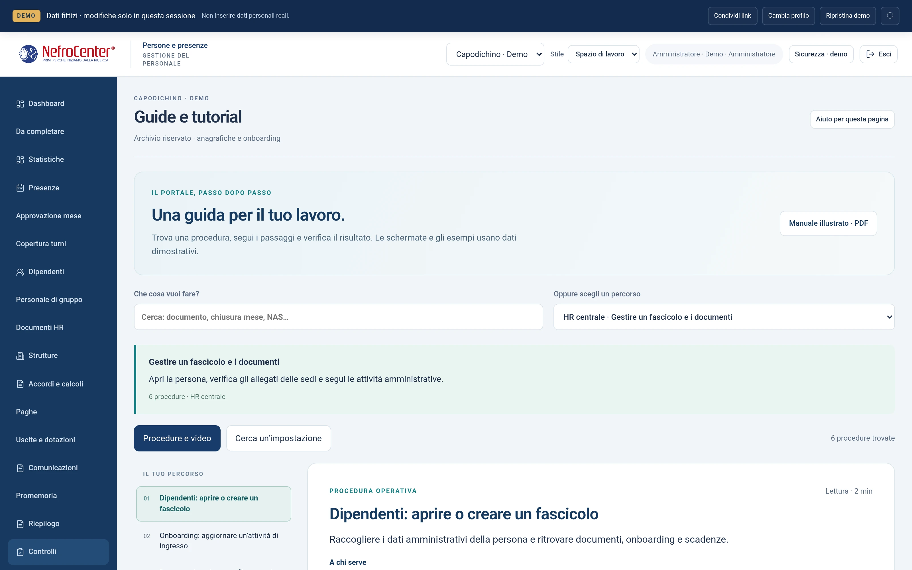

*Schermata dimostrativa del portale.*

1. Apri Guide e tutorial. Parti da un percorso per ruolo oppure cerca una parola, come documento, approvazione, IBAN o backup.
2. Apri la procedura e leggi Per chi, Prima di iniziare e obiettivo. Segui i passaggi nell’ordine indicato.
3. Confronta il risultato atteso con ciò che vedi nel portale. L’esempio è fittizio: usa solo dati aziendali verificati nell’installazione operativa.
4. Per un singolo campo passa a Riferimento impostazioni: leggi effetto ed esempio prima di cambiare un valore.
5. Nella videoguida usa pausa, capitoli e sottotitoli per seguire un passaggio. La trascrizione conserva anche il testo consultabile.
6. Dalla pagina di lavoro usa Aiuto per questa pagina e Avvia tour: vengono evidenziati solo i comandi disponibili e visibili, senza eseguire salvataggi.

**Esempio pratico:** Cerchi “approvazione”: apri la guida del mese, verifica il ruolo del passaggio e poi torna alla pagina per eseguirlo.

**Risultato atteso:** Hai una procedura collegata al lavoro da svolgere e un controllo finale per capire se l’operazione è riuscita.

**Problemi frequenti:**

- Comando del tour non visibile: apri prima la pagina o la sezione indicata.
- Campo o azione assenti: controlla ruolo, sede e stato del dato; la guida non amplia le autorizzazioni.

**Videoguida locale:** [video illustrato](assets/guides/guida.mp4) · [trascrizione](assets/guides/guida.txt)

## Strutture: aggiornare la rubrica condivisa

**A chi serve:** HR centrale e amministratori; responsabili nei centri assegnati

Mantenere recapiti e referenti della sede in un solo punto, consultabile dai fascicoli collegati.

**Prima di iniziare:**

- HR centrale e amministratori vedono tutte le sedi; i responsabili soltanto quelle assegnate.
- Verifica gli indirizzi HR e amministrativi prima di usarli per comunicazioni o promemoria.

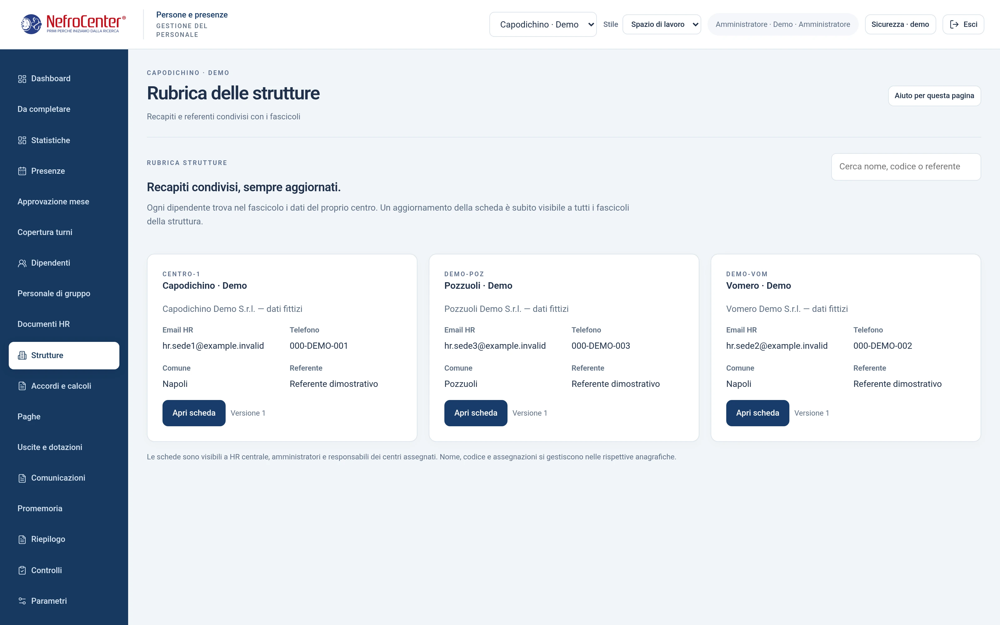

*Schermata dimostrativa del portale.*

1. Apri Strutture e cerca per nome, codice o referente. Premi Apri scheda sulla sede corretta.
2. Completa ragione sociale, riferimenti fiscali e indirizzo disponibili. I campi della rubrica sono facoltativi.
3. Registra separatamente email generale, HR, amministrazione e PEC: un solo indirizzo per campo.
4. Indica telefono, referente, direttore e sito web completo di https://. Usa le note per informazioni organizzative aggiornate.
5. Premi Salva struttura. Nel fascicolo di un dipendente apri Struttura di riferimento per verificare gli stessi recapiti.
6. Se modifichi un recapito usato dai promemoria, l’amministratore deve controllare e riconfermare i destinatari nella loro configurazione.

**Esempio pratico:** Cambia il referente HR della sede: aggiorni l’email nella rubrica e controlli il fascicolo di una persona della stessa struttura.

**Risultato atteso:** Tutti i fascicoli della sede mostrano i riferimenti aggiornati, senza ricopiare la rubrica per ogni persona.

**Problemi frequenti:**

- Email non valida: usa un solo indirizzo, senza nome del destinatario o righe aggiuntive.
- Versione cambiata: riapri la scheda e confronta i dati salvati da un collega.
- Cambiare la rubrica non trasferisce il dipendente e non modifica le sue presenze.

### Impostazioni e campi

| Campo | Effetto | Esempio |
|---|---|---|
| Ragione sociale | Identifica la società o l’ente di riferimento della struttura; non cambia il nome del centro nelle presenze. | NefroCenter Demo S.r.l. |
| Partita IVA | Conserva il riferimento fiscale della struttura; non certifica la posizione fiscale. | Riporta il dato aziendale verificato. |
| Codice fiscale della struttura | Conserva il codice fiscale dell’ente, se diverso o necessario. | Inserisci il codice comunicato dall’amministrazione. |
| Indirizzo della struttura | Indirizzo della sede di riferimento condiviso con i fascicoli del centro. | Via Esempio 10. |
| Comune della struttura | Comune della sede, distinto dalla residenza del dipendente. | Napoli. |
| CAP della struttura | Codice postale della sede. | 80100, solo come esempio. |
| Provincia della struttura | Provincia della sede. | NA. |
| Telefono della struttura | Recapito telefonico organizzativo; il gestionale non effettua chiamate. | Numero del centralino. |
| Email generale della struttura | Casella ordinaria usata quando la lista seleziona il contatto generale. | sede@example.invalid. |
| Email ufficio HR della struttura | Casella del referente HR disponibile nei fascicoli e nelle liste che scelgono il recapito HR. | hr@example.invalid. |
| Email amministrazione della struttura | Casella amministrativa, distinta da HR e dall’indirizzo personale del dipendente. | amministrazione@example.invalid. |
| PEC della struttura | Conserva il recapito PEC come riferimento. Il modulo email ordinario non effettua invii PEC certificati. | struttura@pec.example.invalid. |
| Sito web della struttura | Indirizzo completo con http:// o https://; non è un collegamento automatico a un servizio esterno. | https://www.example.invalid. |
| Referente della struttura | Nome del contatto organizzativo della sede. | Referente Sede Demo. |
| Direttore della struttura | Nome del responsabile della direzione della struttura. | Direzione Demo. |
| Note organizzative | Informazioni utili ai colleghi autorizzati; massimo 2000 caratteri. | Orari per contattare l’amministrazione. |
| Salva struttura | Aggiorna la versione della scheda e rende i dati disponibili nei fascicoli del centro; non cambia le assegnazioni. | Correggi il telefono una sola volta per tutti i fascicoli. |

**Videoguida locale:** [video illustrato](assets/guides/strutture.mp4) · [trascrizione](assets/guides/strutture.txt)

## Comunicazioni: dal modello all’invio verificato

**A chi serve:** HR centrale e amministratori; configurazione del servizio riservata agli amministratori

Preparare email individuali per una lista, controllando destinatari e testo prima della conferma.

**Prima di iniziare:**

- Modelli, liste e bozze: HR centrale e amministratori. Servizio SMTP: solo amministratore.
- Puoi preparare bozze con SMTP disattivato. Nella demo ogni invio è soltanto simulato.

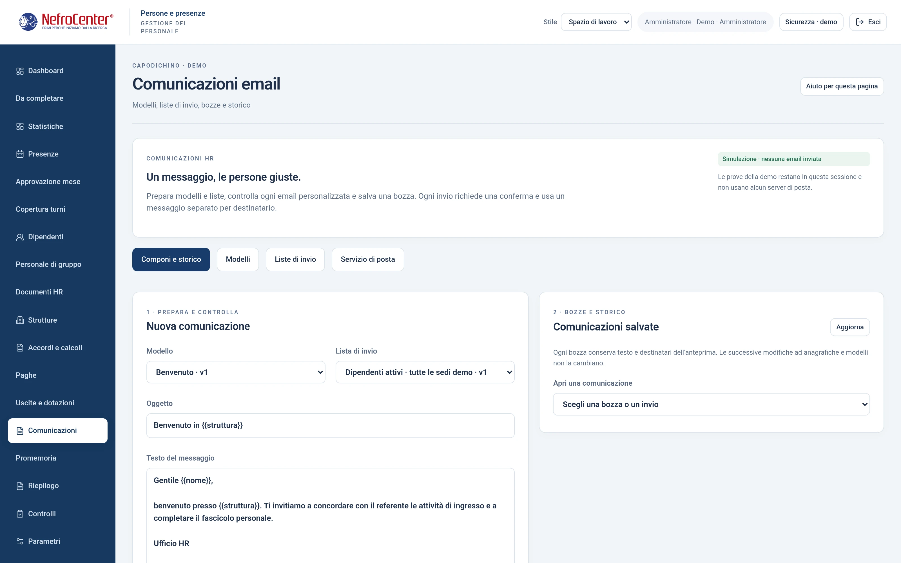

*Schermata dimostrativa del portale.*

1. Apri Comunicazioni e scegli un modello oppure preparane uno con nome, oggetto e testo. Usa solo le variabili elencate dal portale.
2. In Liste scegli dipendenti o contatti delle strutture. Seleziona sedi, filtri e campo email da usare; aggiungi eventuali esclusioni.
3. Nella composizione scegli modello e lista, adatta il messaggio e premi Genera anteprima.
4. Controlla i destinatari effettivi, i duplicati rimossi, gli indirizzi mancanti e i testi personalizzati. Correggi le anomalie e rigenera l’anteprima.
5. Salva la bozza: conserva testi e destinatari come verificati. Le modifiche successive alla rubrica non aggiornano quella bozza.
6. Con SMTP configurato, apri la bozza e conferma il lotto proposto. Ogni email ha un solo destinatario; il lotto successivo richiede una nuova azione.
7. Leggi gli esiti per destinatario. Per le campagne manuali puoi ritentare gli invii falliti; gli esiti incerti e i promemoria automatici richiedono le rispettive verifiche.

**Esempio pratico:** Per ricordare un documento ai referenti delle sedi, prepari una lista dei contatti HR, controlli l’anteprima e confermi il lotto soltanto dopo la verifica.

**Risultato atteso:** La campagna conserva i messaggi preparati e gli esiti dei tentativi, senza esporre la lista agli altri destinatari.

**Problemi frequenti:**

- Accettato SMTP significa preso in carico dal server, non prova della consegna o lettura.
- Anteprima superata: rigenerala se cambiano modello, lista o dati prima della bozza.
- Esito incerto: confronta lo storico del fornitore prima di preparare un altro messaggio per lo stesso destinatario.
- Invio interrotto: Riconcilia invio interrotto, quando disponibile, sospende i tentativi incerti e non spedisce nuovi messaggi.

### Impostazioni e campi

| Campo | Effetto | Esempio |
|---|---|---|
| Nome modello | Etichetta interna per ritrovare il testo precompilato; non è l’oggetto dell’email. | Richiesta documenti mancanti. |
| Oggetto modello | Titolo dell’email, personalizzato con le variabili ammesse. Non inserire righe aggiuntive. | Promemoria per {{nome}}. |
| Testo modello | Corpo dell’email in testo semplice; usa solo le variabili elencate dal portale. | Gentile {{nome}}, contatta il referente di {{struttura}}. |
| Variabili del modello | Sostituiscono i segnaposto con dati del destinatario o della struttura. Anteprima e controlli segnalano variabili o dati non utilizzabili. | {{struttura}} mostra il nome del centro. |
| Nome lista | Etichetta interna della selezione di destinatari. | Personale Sede Demo. |
| Tipo destinatari | Sceglie tra fascicoli dei dipendenti e contatti delle strutture. | Strutture per una comunicazione ai referenti HR. |
| Strutture della lista | Limita i destinatari ai centri selezionati. Nessuna selezione include tutti i centri autorizzati: controlla sempre il totale nell’anteprima. | Seleziona soltanto le sedi coinvolte. |
| Ruoli del personale | Filtra i dipendenti secondo il ruolo registrato; nessuna selezione comprende tutti i ruoli. Non modifica le autorizzazioni al portale. | INF per i fascicoli con ruolo infermieristico. |
| Stati del rapporto | Filtra i fascicoli secondo lo stato selezionato. Nessuna selezione comprende tutti gli stati, anche i cessati. | In ingresso per una comunicazione di benvenuto. |
| Email aziendale o personale | Sceglie esplicitamente il campo del fascicolo. Un indirizzo assente viene segnalato, senza sostituzione nascosta con un altro recapito. | Email aziendale per le comunicazioni interne. |
| Recapito della struttura | Sceglie email generale, HR o amministrazione per una lista di strutture. | Email ufficio HR. |
| Indirizzi esclusi | Esclude dalla selezione gli indirizzi indicati. I duplicati fra destinatari vengono eliminati nell’anteprima. | Escludi una casella che deve ricevere una comunicazione separata. |
| Genera anteprima | Ricalcola destinatari, anomalie e messaggi personalizzati sui dati aggiornati, senza inviare email. | Controlla tutti i destinatari prima di creare la bozza. |
| Salva bozza | Conserva una copia dei destinatari e dei testi verificati. La bozza non si aggiorna quando cambia la lista o la rubrica. | Crea una nuova bozza dopo una correzione dei recapiti. |
| Conferma invio lotto | Avvia esplicitamente un lotto di email individuali; può richiedere conferma di sicurezza. Non iscrive un’attività automatica. | Conferma soltanto dopo aver riletto conteggio e testi. |
| Ritenta falliti | Riprova soltanto i destinatari con errore; non reinvia quelli già accettati e non risolve gli esiti incerti. | Correggi prima la causa indicata dal servizio. |
| Stato invio | Distingue messaggi in attesa, in lavorazione, accettati dal server, falliti o con esito incerto; l’accettazione SMTP non conferma lettura o consegna. | Accettato: il server ha preso in carico il messaggio. |
| Abilita servizio email | Consente gli invii reali solo dopo configurazione e verifica del servizio. Inizialmente è disattivato. | Lascia disattivato finché il fornitore non è definito. |
| Server SMTP | Nome del server fornito dal servizio aziendale; non usare un indirizzo ipotizzato. | Il tecnico inserisce il server comunicato dal fornitore. |
| Porta SMTP | Porta abbinata alla modalità TLS richiesta dal fornitore. | Usa la porta indicata nella documentazione del servizio. |
| Modalità TLS | Sceglie TLS diretto oppure STARTTLS con verifica del certificato. L’invio in chiaro non è previsto. | SSL/TLS o STARTTLS secondo il fornitore. |
| Nome utente SMTP | Account autorizzato a spedire dal servizio aziendale. | Casella tecnica autorizzata. |
| Password del servizio sul server | Il tecnico imposta PRESENZE_SMTP_PASSWORD nell’ambiente del servizio; la password non si salva nei modelli o nella rubrica. | Non incollare credenziali nel testo di una comunicazione. |
| Email mittente | Indirizzo da cui partono i messaggi; deve essere autorizzato dal servizio di posta. | hr@example.invalid come esempio fittizio. |
| Nome mittente | Nome leggibile mostrato accanto all’indirizzo del mittente. | Ufficio HR. |
| Rispondi a | Casella a cui indirizzare le risposte quando diversa dal mittente. | ufficio.personale@example.invalid. |
| Dimensione lotto | Da 1 a 20 messaggi elaborati con una conferma; i successivi richiedono un nuovo avvio. | Usa lotti piccoli nella prova iniziale; valore iniziale 20. |
| Limite orario | Da 1 a 2000 tentativi nell’ultima ora; rispetta anche i limiti del servizio aziendale, che possono essere più bassi. | Concorda il valore con il tecnico; valore iniziale 100. |

**Videoguida locale:** [video illustrato](assets/guides/comunicazioni.mp4) · [trascrizione](assets/guides/comunicazioni.txt)

## Approvazione mese: seguire i tre passaggi

**A chi serve:** Tutti leggono le sedi autorizzate; invio ai compilatori e responsabili, verifica ai responsabili, approvazione finale a HR e amministratori

Far controllare le presenze alla sede, al responsabile e a HR prima della chiusura.

**Prima di iniziare:**

- L’amministratore deve attivare il flusso per la sede. Nella demo è già attivo.
- L’invio è disponibile a compilatori, responsabili e amministratori; la verifica al responsabile; l’approvazione finale a HR o amministratore.

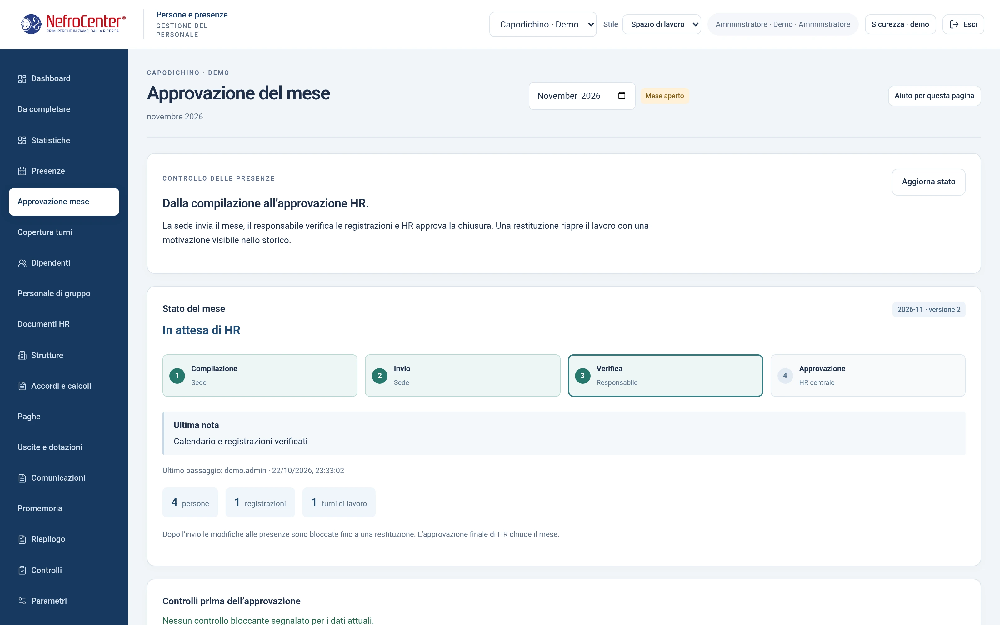

*Schermata dimostrativa del portale.*

1. Apri Approvazione mese e controlla centro, mese, stato e Controlli prima dell’approvazione.
2. Se serve attivarlo, l’amministratore apre Configurazione del flusso, seleziona la richiesta di verifica e approvazione HR, motiva e salva.
3. La sede completa i consuntivi e risolve i blocchi, poi preme Invia al responsabile. Da questo momento le presenze sono protette dalle modifiche.
4. Il responsabile controlla dati e calendario, spunta la verifica e usa Conferma verifica e invia a HR. Se serve correggere, usa Restituisci per correzioni con una nota di almeno 8 caratteri.
5. HR controlla il mese e usa Approva e chiudi mese oppure lo restituisce con motivazione. HR non modifica direttamente le presenze.
6. Dopo una restituzione, la sede corregge e invia nuovamente. Dopo la chiusura, una riapertura motivata invalida l’approvazione e richiede di ripetere il percorso.
7. Consulta lo Storico dei passaggi. Se i dati di riferimento sono cambiati, restituisci e verifica la nuova versione prima dell’approvazione o dell’esportazione paghe.

**Esempio pratico:** La sede invia ottobre; il responsabile rileva un’uscita mancante e restituisce il mese. Dopo la correzione, sede, responsabile e HR ripetono i rispettivi passaggi.

**Risultato atteso:** Lo stato è Approvato da HR e il periodo è chiuso; lo storico identifica autore, momento e motivo dei passaggi.

**Problemi frequenti:**

- Pulsante assente: controlla ruolo, sede e stato; ogni passaggio è disponibile solo al ruolo previsto.
- Invio bloccato: completa consuntivi, orari richiesti o sedi importate non definite indicati nei controlli.
- Versione cambiata: Aggiorna stato prima di decidere; non approvare dati diversi da quelli verificati.
- Mese già chiuso prima del flusso: resta storico precedente, senza approvazione HR attribuita retroattivamente.

### Impostazioni e campi

| Campo | Effetto | Esempio |
|---|---|---|
| Richiedi verifica del responsabile e approvazione finale HR | Attiva il percorso per il centro selezionato. Le sedi esistenti partono con questa opzione disattivata. I mesi già chiusi restano storici precedenti. Solo l’amministratore può modificarla. | Attivare dopo aver concordato il processo con la sede e con HR. |
| Motivo della modifica | Registra la motivazione dell’attivazione o disattivazione; richiede almeno 8 e al massimo 2000 caratteri. | Avvio del processo mensile concordato con HR. |
| Nota del passaggio | Accompagna il passaggio nello storico visibile agli utenti autorizzati della sede. È obbligatoria con almeno 8 caratteri per restituzione e riapertura; limite 2000 caratteri. | Correggere l’orario di uscita del turno del 14 ottobre. |
| Ho verificato calendario e parametri del mese | Conferma la verifica del calendario durante il passaggio del responsabile. Se il mese non era già verificato, la conferma è necessaria per inviarlo a HR. | Confermare dopo aver controllato festività, giorni lavorativi e regole del mese. |

**Videoguida locale:** [video illustrato](assets/guides/approvazioni.mp4) · [trascrizione](assets/guides/approvazioni.txt)

## Copertura turni: trovare e gestire le scoperture

**A chi serve:** Copertura aggregata: tutti i ruoli nei centri autorizzati. Note e proposte: HR e responsabili. Minimi e conferma sostituzioni: responsabile della destinazione o amministratore.

Confrontare il personale pianificato con i minimi della sede e valutare una sostituzione.

**Prima di iniziare:**

- I minimi sono riferimenti organizzativi definiti dalla sede, non una certificazione clinica.
- Tutti vedono i conteggi autorizzati; disponibilità e note sono riservate a HR e responsabili.

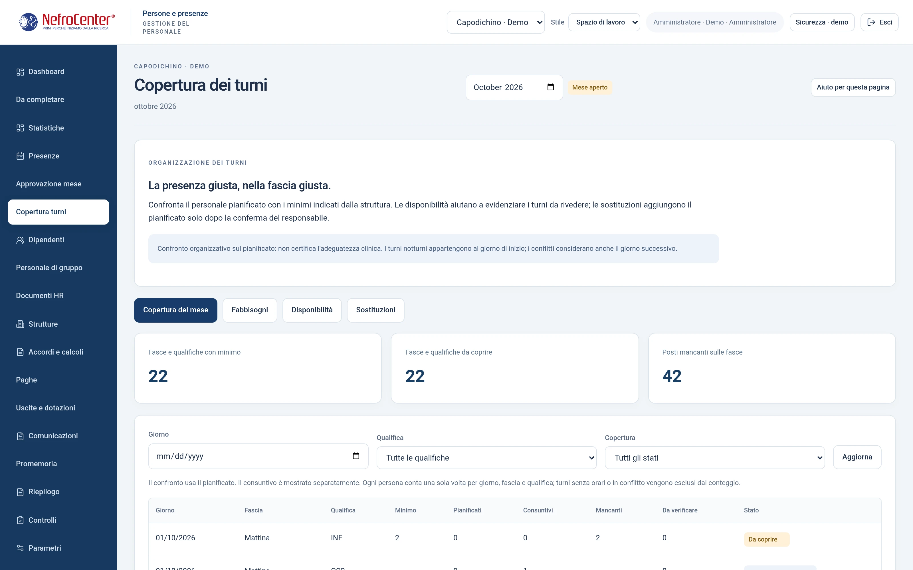

*Schermata dimostrativa del portale.*

1. Scegli centro e mese e apri Copertura turni. In Copertura del mese leggi minimi, pianificati, consuntivi e mancanti separatamente.
2. In Fabbisogni il responsabile definisce giorno della settimana, fascia, qualifica e minimo. Un’eccezione per data prevale sulla settimana tipo. Salva e controlla il riepilogo.
3. In Disponibilità HR o il responsabile registra persona, intervallo e indicazione. Non disponibile esclude il pianificato in conflitto; Disponibile e Preferenza non assegnano un turno.
4. Prima di proporre tra sedi, verifica che le due anagrafiche della stessa persona siano collegate in Personale di gruppo e che il proponente possa accedere a entrambe le sedi.
5. In Sostituzioni scegli persona e sede d’origine, giorno, fascia e causale di lavoro della destinazione. Motiva e invia la proposta.
6. Il responsabile della destinazione o l’amministratore controlla e usa Accetta e pianifica oppure Rifiuta, con nota. All’accettazione il programma ricontrolla disponibilità e conflitti.
7. Aggiorna la copertura. Per il lavoro effettivamente svolto registra poi il Consuntivo nelle Presenze.

**Esempio pratico:** La mattina richiede due infermieri ma ne risulta uno disponibile: il responsabile verifica una persona già collegata alle due sedi e propone il turno alla destinazione.

**Risultato atteso:** Le fasce da coprire sono visibili; una proposta accettata crea un solo turno pianificato e conserva la decisione.

**Problemi frequenti:**

- Nessun candidato: controlla anagrafiche attive, identità collegate e accesso alle due sedi.
- Turno escluso: risolvi indisponibilità, sovrapposizioni o orari mancanti prima di contarlo come coperto.
- Mese inviato o chiuso: non puoi aggiungere il pianificato fino al passaggio autorizzato.
- Proposta superata: rifiutala e preparane una aggiornata dopo aver verificato i nuovi dati.

### Impostazioni e campi

| Campo | Effetto | Esempio |
|---|---|---|
| Giorno | Mostra le fasce del giorno scelto nel mese selezionato. | 5 ottobre: tutte le fasce del giorno. |
| Qualifica | Filtra i conteggi per la qualifica valida nella data del turno, considerando le decorrenze registrate. | INF: personale con qualifica infermieristica nella data. |
| Copertura | Seleziona fasce da coprire, coperte, sopra il minimo o senza minimo configurato. | Da coprire: pianificati validi inferiori al minimo. |
| Giorno della settimana | Ripete il riferimento organizzativo ogni settimana. Non modifica i turni già registrati. | Lunedì per la fascia Mattina. |
| Data dell’eccezione | Sostituisce il minimo settimanale della stessa fascia e qualifica solo nella data indicata. | Una festività con minimo zero. |
| Fascia | Associa il minimo a una fascia attiva della configurazione del centro. | Mattina, Pomeriggio o Notte. |
| Qualifica del fabbisogno | Indica quale qualifica concorre al confronto del minimo. | INF e MED hanno minimi distinti. |
| Personale minimo | Numero intero da 0 a 1000 scelto dal responsabile; ogni persona conta una volta per giorno, fascia e qualifica. | Minimo 3, pianificati 2: un posto mancante. |
| Rimuovi riga | Toglie il minimo al salvataggio. Rimuovere un’eccezione rende nuovamente applicabile il minimo settimanale. | Elimina un’eccezione non più necessaria e salva. |
| Persona | Seleziona l’anagrafica del centro. Una disponibilità esistente conserva la stessa persona. | Scegli la persona prima di inserire le date. |
| Dal giorno | Primo giorno incluso nell’indicazione. Due indicazioni attive della stessa persona e sede non possono sovrapporsi. | Dal 5 ottobre. |
| Al giorno incluso | Ultimo giorno incluso; intervallo massimo 367 giorni. Le indisponibilità considerano anche la fine di un turno notturno. | Al 6 ottobre include tutto il giorno 6. |
| Indicazione | Disponibile o Preferenza non creano turni; Non disponibile impedisce sostituzioni in conflitto ed esclude i pianificati interessati dalla copertura. | Non disponibile durante un periodo concordato. |
| Nota riservata ai referenti HR | Testo organizzativo fino a 1000 caratteri visibile solo a HR, amministratori e responsabili autorizzati. | Disponibilità concordata con il referente. |
| Indicazione attiva | Togliere la spunta ritira l’indicazione dai controlli mantenendola nell’elenco e nell’audit. | Ritira un’indisponibilità annullata. |
| Persona e struttura di origine | Mostra solo persone attive collegate esplicitamente tra la destinazione e un’altra sede accessibile. | La stessa persona già censita in due strutture. |
| Giorno del turno | Identifica il giorno d’inizio del turno pianificato, anche quando termina il giorno successivo. | Notte del 5: inizia il 5 e termina il 6. |
| Fascia di destinazione | Usa gli orari e la pausa della fascia del mese di destinazione. | Mattina dalle 07:00 alle 13:00 se così configurata. |
| Causale di lavoro | Consente solo causali attive di lavoro ammesse nella fascia scelta. | Mattina per la fascia Mattina. |
| Motivazione della sostituzione | Nota obbligatoria da 8 a 1000 caratteri conservata con la proposta. | Copertura concordata per la fascia scoperta. |
| Motivazione / controllo effettuato | Registra la ragione dell’accettazione o del rifiuto; richiede da 8 a 1000 caratteri. | Verificate disponibilità e assenza di sovrapposizioni. |
| Confermo persona, giorno e fascia | La conferma consente di aggiungere il solo pianificato. Mese bloccato, dati modificati o conflitti impediscono l’accettazione. | Controlla il riepilogo prima di Conferma e registra pianificato. |

**Videoguida locale:** [video illustrato](assets/guides/copertura.mp4) · [trascrizione](assets/guides/copertura.txt)

## Promemoria: configurare destinatari e scadenze

**A chi serve:** HR centrale e amministratori; configurazione solo amministratori

Programmare riepiloghi HR dopo aver verificato destinatari, contenuti e limiti di invio.

**Prima di iniziare:**

- HR centrale consulta; soltanto l’amministratore configura e attiva la programmazione.
- Per gli invii reali occorrono SMTP abilitato e server acceso. Nella demo gli esiti sono simulati.

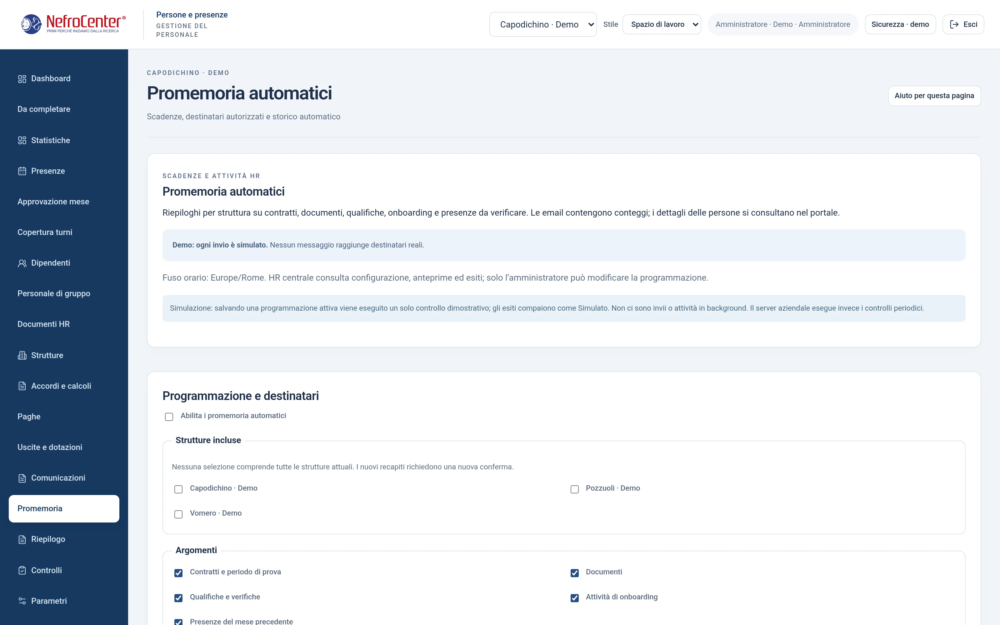

*Schermata dimostrativa del portale.*

1. Apri Promemoria e controlla lo stato. La prima installazione parte disattivata; il servizio di posta si configura in Comunicazioni.
2. Scegli strutture e argomenti. Nessuna sede selezionata significa tutte le sedi; verifica sempre il perimetro nell’anteprima.
3. Imposta giorni di anticipo, limite degli arretrati, ora italiana e massimo quotidiano. Per esempio 30,15,7,0 indica le soglie prima della scadenza.
4. Scegli email HR delle strutture, ufficio HR centrale oppure entrambi. I recapiti delle sedi arrivano da Strutture; non vengono usate le email personali dei dipendenti.
5. Seleziona l’abilitazione e premi Genera anteprima. Controlla tutti gli indirizzi e i riepiloghi: contengono conteggi per sede, senza nomi dei dipendenti o allegati.
6. Conferma i recapiti e premi Salva programmazione. Per sospendere, togli l’abilitazione e salva. Cambi di configurazione o recapiti richiedono una nuova verifica.
7. Controlla lo storico. Gli errori e gli esiti incerti non vengono reinviati automaticamente né dalle campagne manuali: verifica il servizio di posta prima di agire.

**Esempio pratico:** Configuri promemoria a 15 e 7 giorni per i documenti e scegli l’email HR di una sede; l’anteprima mostra i conteggi da inviare a quel referente.

**Risultato atteso:** Il server elabora gli eventi previsti entro i limiti configurati, evitando copie dello stesso evento e anticipo allo stesso recapito.

**Problemi frequenti:**

- Anteprima senza messaggi: controlla soglie, arretrati, eventi già gestiti e attività completate.
- Recapito assente o cambiato: aggiorna Strutture, genera una nuova anteprima e riconferma.
- Server spento: i controlli riprendono al riavvio entro il limite degli arretrati; non viene eseguito un invio mentre il servizio è fermo.
- Dopo un ripristino i promemoria sono disattivati: confronta gli invii con il fornitore prima della riattivazione.

### Impostazioni e campi

| Campo | Effetto | Esempio |
|---|---|---|
| Attivazione | Abilita i controlli automatici dopo il salvataggio. Richiede SMTP pronto, anteprima aggiornata e conferma dei recapiti. | Disattiva e salva per sospendere i prossimi messaggi. |
| Strutture incluse | Limita le sedi da controllare. Nessuna selezione include tutte; un nuovo recapito richiede riconferma. | Seleziona due strutture per avviare una prova aziendale. |
| Argomenti | Seleziona le attività da riepilogare: contratti/prova, documenti, qualifiche, onboarding e presenze precedenti. | Documenti e qualifiche per il controllo amministrativo. |
| Anticipi in giorni | Da uno a otto interi fra 0 e 365, separati da virgola. Ogni soglia viene elaborata una volta per evento e recapito; 0 copre scadenza e arretrati. | 30,15,7,0. |
| Arretrati: massimo giorni | Da 1 a 90 giorni. Le scadenze più vecchie restano consultabili nel portale e sono escluse dai riepiloghi automatici. | 30 esclude gli eventi scaduti da oltre un mese. |
| Destinazione | Referente HR della struttura, solo ufficio HR centrale o entrambi. Indirizzi uguali per la stessa sede sono deduplicati. | Entrambi per informare sede e ufficio centrale. |
| Email ufficio HR centrale | Recapito esplicito obbligatorio per destinazione centrale o entrambe; non utilizza indirizzi personali dei dipendenti. | hr@esempio.it. |
| Ora locale di avvio | Intero da 0 a 23 nel fuso Europe/Rome. Il worker controlla periodicamente dopo questa ora; non è un appuntamento al minuto. | 8 per iniziare i controlli al mattino. |
| Massimo messaggi al giorno | Limite da 1 a 200 per tutti i riepiloghi automatici. Si sommano anche i vincoli orari e di lotto SMTP condivisi con le comunicazioni. | 20 per contenere il volume quotidiano. |
| Genera anteprima | Calcola gli eventi correnti e mostra tutti i recapiti da autorizzare. Non effettua invii. Mostra fino a 100 messaggi di esempio e il totale completo. | Controlla il recapito di ogni struttura prima di confermare. |
| Conferma dei recapiti | Autorizza gli invii programmati ai recapiti dell’anteprima, anche per eventi futuri, solo con questa configurazione. Ogni modifica invalida l’anteprima. | Spunta dopo aver controllato tutti gli indirizzi. |
| Salva programmazione | Salva la versione corrente; respinge modifiche concorrenti e abilitazioni prive di conferma valida. Solo amministratore. | Salva dopo avere disabilitato per fermare i prossimi invii. |
| Aggiorna esiti | Rilegge lo stato e lo storico senza avviare invii. Le modifiche locali non salvate restano nella sessione. | Aggiorna dopo l’ora programmata. |
| Storico e riepilogo | Mostra fino a 100 messaggi con destinatario, conteggio eventi, contenuto ed esito. Accettazione SMTP non garantisce consegna. | Apri Leggi riepilogo per verificare un messaggio. |

**Videoguida locale:** [video illustrato](assets/guides/promemoria.mp4) · [trascrizione](assets/guides/promemoria.txt)

## Uscite e dotazioni: completare la riconsegna

**A chi serve:** HR centrale, amministratori e responsabili dei centri assegnati

Seguire cessazione o trasferimento e chiudere il percorso solo dopo attività e restituzioni.

**Prima di iniziare:**

- HR centrale, amministratori e responsabili gestiscono le sedi autorizzate.
- Per il trasferimento serve accesso sia all’origine sia alla destinazione.

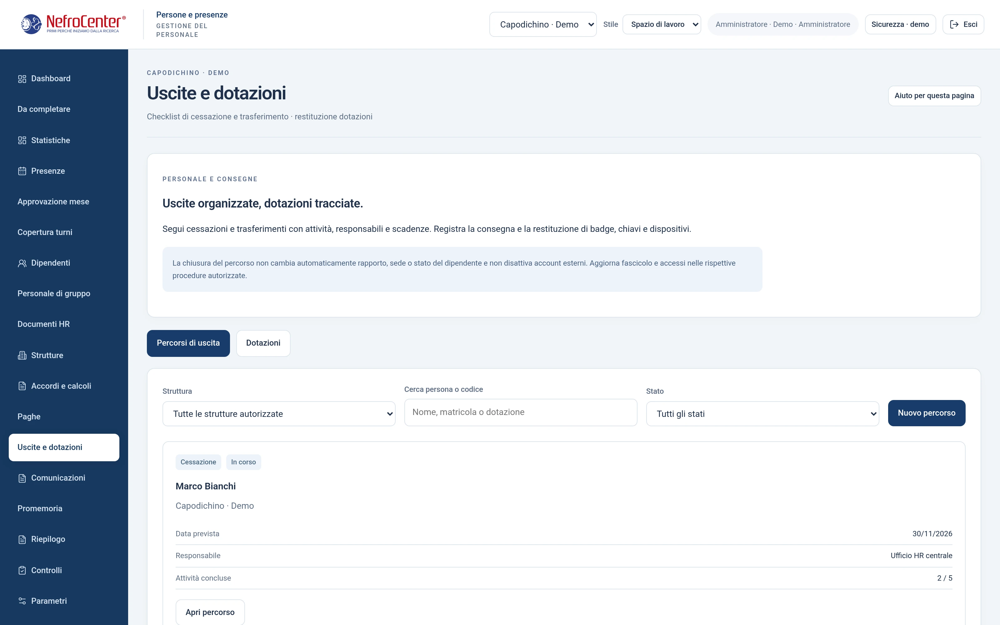

*Schermata dimostrativa del portale.*

1. Apri Uscite e dotazioni. In Dotazioni premi Registra consegna per affidare un bene: scegli persona, tipo, codice inventario, descrizione e data effettiva.
2. In Percorsi di uscita premi Nuovo percorso. Indica persona, Cessazione o Trasferimento, data prevista, referente e motivazione di almeno 8 caratteri.
3. Apri il percorso e aggiorna le attività per badge, chiavi, dispositivi, documenti e accessi: stato, scadenza, responsabile e nota. Non applicabile richiede una motivazione.
4. Quando un bene è realmente riconsegnato, usa Registra restituzione e indica data e condizioni. Danni o inutilizzabilità richiedono una descrizione.
5. Controlla i blocchi. Completa percorso è disponibile solo con attività obbligatorie concluse o motivate e nessuna dotazione ancora assegnata. Inserisci la nota finale e conferma.
6. Consulta lo storico. Annulla percorso conserva le dotazioni ancora affidate; una restituzione registrata non viene riscritta.
7. Completa separatamente le modifiche autorizzate a fascicolo, sedi e account: chiudere il percorso non cessa il rapporto, non trasferisce la persona e non disabilita accessi esterni.

**Esempio pratico:** Alla cessazione una persona restituisce il badge ma conserva un dispositivo da riconsegnare: il percorso rimane aperto finché la restituzione non è registrata.

**Risultato atteso:** La chiusura documenta verifiche e restituzioni; le attività mancanti restano visibili prima della conferma.

**Problemi frequenti:**

- Percorso già aperto: gestisci quello corrente oppure annullalo con motivazione prima di crearne un altro.
- Completa percorso disabilitato: controlla checklist e dotazioni assegnate.
- Codice inventario già affidato: registra la restituzione effettiva prima di una nuova consegna nella stessa sede.
- Consegna e restituzione effettive non possono essere future; la restituzione non può precedere la consegna.

### Impostazioni e campi

| Campo | Effetto | Esempio |
|---|---|---|
| Struttura | Limita i risultati ai centri autorizzati; Tutte mostra il perimetro del tuo account. | Centro Uno. |
| Cerca persona o codice | Cerca nome, matricola, responsabile, codice inventario o descrizione. | BADGE 001. |
| Stato | Filtra i percorsi per avanzamento oppure le dotazioni per restituzione. | Da restituire. |
| Struttura del percorso | Sede di provenienza della persona; non modificabile dopo la creazione. | Centro Uno. |
| Dipendente | Anagrafica della sede, anche non attiva; non modificabile dopo la creazione. | Persona Demo · DEM001. |
| Tipo | Cessazione o Trasferimento; quest’ultimo richiede la destinazione. | Trasferimento. |
| Data prevista | Data organizzativa prevista per cessazione o trasferimento; le attività iniziali la usano come scadenza. | 2026-11-30. |
| Struttura di destinazione | Deve essere diversa e autorizzata. Il percorso non copia né trasferisce i dati della persona. | Centro Due. |
| Responsabile del percorso | Referente nominativo o ufficio incaricato; assegnato inizialmente anche alle attività. | Ufficio HR centrale. |
| Motivazione | Testo di almeno 8 caratteri per spiegare il percorso. | Trasferimento concordato alla sede Due. |
| Stato attività | Da fare, In corso, Completata o Non applicabile. Solo gli ultimi due soddisfano il blocco della chiusura. | Completata dopo conferma di IT. |
| Scadenza attività | Data entro cui svolgere l’attività; aggiornabile senza cambiare la data del percorso. | 2026-11-28. |
| Responsabile attività | Referente che deve completare la specifica attività. | Referente IT aziendale. |
| Nota attività | Spiega l’esito o la non applicabilità; per Non applicabile servono almeno 8 caratteri. | Nessuna chiave affidata al dipendente. |
| Motivazione / verifica effettuata | Nota finale obbligatoria per completamento o annullamento, almeno 8 caratteri. | Attività e restituzioni verificate. |
| Conferma completamento | Richiesta per completare; ricorda che anagrafiche e accessi si aggiornano separatamente. | Conferma dopo le verifiche finali. |
| Struttura consegna | Sede che gestisce la consegna e il codice inventario. | Centro Uno. |
| Dipendente assegnatario | Persona del centro a cui è stata affidata la dotazione. | Persona Demo. |
| Tipo dotazione | Badge, Chiavi, Dispositivo oppure Altra dotazione. | Dispositivo. |
| Codice inventario | Identificatore obbligatorio, unico tra le assegnazioni attive della sede; maiuscole e spazi ripetuti non creano codici distinti. | PC 042. |
| Descrizione dotazione | Descrizione riconoscibile del bene consegnato. | Notebook ufficio HR. |
| Data consegna | Data effettiva, non futura. Persona, tipo, codice e data di consegna non possono essere riscritti dopo la registrazione. | 2026-10-22. |
| Restituzione prevista | Facoltativa; non può precedere la consegna. Una data superata evidenzia il ritardo. | 2026-11-30. |
| Nota consegna | Informazioni utili sulla consegna, senza password o codici di accesso. | Consegnato con alimentatore. |
| Data restituzione | Data effettiva tra la consegna e oggi. | 2026-10-22. |
| Condizioni | Buone condizioni, Danneggiata o Non utilizzabile. | Danneggiata. |
| Nota restituzione | Descrizione dei problemi obbligatoria, almeno 8 caratteri, per beni danneggiati o inutilizzabili. | Schermo danneggiato sul lato destro. |
| Storico e versione | Percorsi: ultimi 100 aggiornamenti; dotazioni: ultimi 50. La versione impedisce sovrascritture concorrenti. | Autore e data della restituzione. |

**Videoguida locale:** [video illustrato](assets/guides/uscite.mp4) · [trascrizione](assets/guides/uscite.txt)
